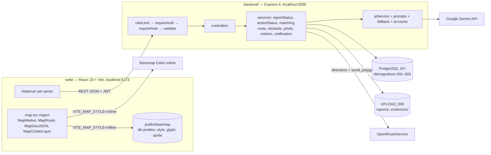
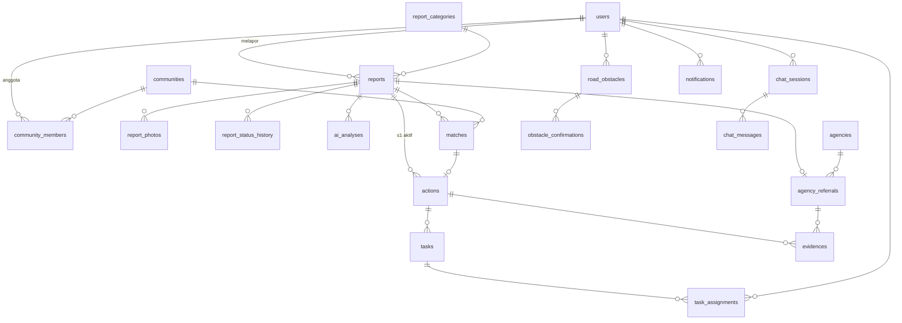

# SDD SUSI Connect — Software Design Document

**Tanggal:** 22 Oktober 2026 · **Versi:** 2.2 · **Sumber kebenaran teknis** (fitur: [PRD.md](PRD.md))
**Dokumen terkait:** [API.md](API.md) · [AI-PROMPTS.md](AI-PROMPTS.md) · [UI-SPEC.md](UI-SPEC.md) · [TICKETS.md](TICKETS.md) · [`db/migrations/`](../db/migrations)

## Log Perubahan

| Versi | Tanggal | Perubahan |
| --- | --- | --- |
| 1.0 | 22 Okt 2026 | SDD awal (Claude Docs). |
| 2.0 | 22 Okt 2026 | **Struktur:** dua repo → **monorepo** `susi-connect` (`backend/`, `web/`, `db/`, `docs/`); migrasi pindah dari `backend/src/db/migrations/` ke `db/migrations/` di root. **Skema:** ALTER di §7 v1 digabung ke file migrasi 001–005 final; tambah `areas`, `report_categories`, `users.is_demo`, `reports.reject_reason`, `matches.status='kedaluwarsa'`, `tasks.needs_route`, `actions.match_id`, `road_obstacles.source_role`, `notifications.title/body`. **Konfigurasi DB:** `pool.js` repo lama memakai `DB_HOST/DB_PORT/DB_USER/DB_PASSWORD/DB_NAME`, SDD v1 menulis `DATABASE_URL` → dipilih **`DATABASE_URL`** dan `pool.js` diubah (§2.2). **State machine:** digabung dari PRD v1 §10 dan SDD v1 §6.1 — `forward` boleh dari `menunggu` **dan** `diverifikasi`; ditambah event `return` dan `reopen` yang ada di PRD tetapi hilang di SDD v1; pembatalan aksi kembali ke `diverifikasi` oleh sistem (bukan koordinator). **API:** dipindah ke API.md; `GET /routes` (bukan POST); `source` rute `ors/cache/straight`; JSON snake_case. **Peta:** SDD v1 menyebut `MapClusterLayer` dengan warna per status — komponen itu hanya punya satu `pointColor` (map.tsx baris 1885–1911), jadi peta kerja memakai `MapMarker` per laporan dan `MapClusterLayer` hanya untuk peta publik (§8.6). **Wilayah:** pilot = Provinsi DKI Jakarta (daratan), kecamatan demo utama Tebet [ASUMSI]. **Kepemilikan:** `matching.service`, `metrics.service`, upload/foto, geo/hambatan, match API, notifikasi, komunitas/kanal/admin API ditulis DA, direview BE (TICKETS.md §0). **Izin panitia:** pemakaian kode repo lama sudah diizinkan (jawaban tim 22 Okt). |
| 2.1 | 22 Okt 2026 | Atas permintaan tim, frontend **mempertahankan tampilan & layout smartroute-dashboard**: tema gelap (`dark-1/2`, `light-1/2`, `red-1`, `green-1`), font Plus Jakarta Sans + Source Code Pro, layout `Dashboard.tsx` (KPI + grid kartu) dan peta layar penuh `Map.tsx` dengan panel mengambang & modal. Halaman/komponen lama kini **diubah**, bukan dihapus (§2.3); komponen turunan baru di §8.4; `MapWorkspace` multi-mode di §8.5–8.6; gaya §8.7 diganti. Temuan baru T13: font dari Google Fonts (gagal offline). |
| 2.2 | 22 Okt 2026 | Hasil audit: (1) T14 — build web gagal karena `baseUrl` (TS 6); (2) `file-type` ESM-only → cek magic bytes sendiri (§6.7); (3) `?token=` hanya untuk `/files/*` (§5.2); (4) kunci `route_cache` memakai geometri hambatan, bukan id — sebelumnya cache gladi tidak pernah kena saat hambatan dibuat ulang di demo (§6.5, §10.3); (5) K1 menambah `breakdown` untuk `StatusSummaryCard`/`ActionsStatusCard` yang sebelumnya tidak punya sumber data (§6.6, §8.1); (6) data buatan akun sintetis ikut `is_synthetic` (§6.9). |

---

## 1. Keputusan desain

| No | Keputusan | Isi | Alasan |
| --- | --- | --- | --- |
| D1 | Jalur `campuran` | Saat `verify`, aksi komunitas dan rujukan instansi (`origin='campuran'`) dibuat bersama. Status laporan mengikuti jalur komunitas; rujukan punya status sendiri dan tidak memblokir `selesai`. | Keputusan tim. |
| D2 | Peran dua tingkat | `users.role` ∈ `warga, moderator, instansi, admin` (+ `scope_kecamatan`); relawan/koordinator per komunitas di `community_members`. | Keputusan tim. |
| D3 | Backend | JavaScript **CommonJS**, Express 4, `pg` (SQL mentah), **zod**. Tanpa ORM/TypeScript. | Pola repo lama. |
| D4 | Frontend | React 19 + TypeScript + Vite + Tailwind v4 + shadcn (`base-nova`) + mapcn (`components/ui/map.tsx`, MapLibre GL 6.6). | Repo lama. |
| D5 | Monorepo | Satu repo GitHub `susi-connect` untuk submission. | Jawaban tim; satu tautan & satu tag. |
| D6 | Migrasi | File SQL bernomor `db/migrations/00N_*.sql`, dijalankan `backend/src/db/migrate.js` satu transaksi per file, dicatat di `schema_migrations`. | `db:init` lama merujuk `schema.sql` yang tidak ada. |
| D7 | Data fetching | `lib/apiClient.ts` (fetch) + hook per sumber data; tanpa React Query/state global. | Pola `services/api.ts` + `useStations`. |
| D8 | Routing | Backend memanggil OpenRouteService; frontend menggambar GeoJSON dengan `MapRoute`. | Kunci API di server; cache & fallback terpusat. |
| D9 | AI | `aiService.run(purpose, input)` dengan zod, timeout 10 dtk, cache, fallback aturan; tidak pernah melempar. | PRD §9 M04, M13. |
| D10 | Triase asinkron | `POST /reports` membalas 201 sebelum triase; frontend polling. | Gemini lambat tidak membuat warga menunggu. |
| D11 | Snake_case | JSON API = nama kolom DB. | Mengurangi pemetaan; repo lama juga meneruskan baris pg. |
| D12 | Offline | `AI_MODE`, `ROUTING_MODE`, `VITE_MAP_STYLE=offline` (PMTiles DKI). | Grand Final di localhost tanpa jaminan internet. |
| D13 | Wilayah | `PILOT_BOUNDS` = DKI Jakarta daratan; `areas` berisi kelurahan; moderator/instansi per kecamatan. | Jawaban tim. |
| D14 | Uji | `node:test` (unit) + `supertest` (API) + gladi manual. | Tanpa dependensi uji berat. |
| D15 | Upload | multer memory → `sharp` re-encode WebP 1280 px (EXIF hilang) → disk `UPLOAD_DIR`. | Privasi foto. |

---

## 2. Kondisi repo lama & langkah perubahan

Kedua repo diperiksa langsung (commit terakhir: backend `fecdbc0 feat: auth`, frontend `b1787c9 feat: auth`, branch `main`).

### 2.1 Temuan yang harus diperbaiki di Hari 1

| No | Temuan (terverifikasi) | Lokasi | Perbaikan | Tiket |
| --- | --- | --- | --- | --- |
| T1 | Semua route tanpa autentikasi; `POST /api/admins` terbuka | `backend/src/routes/adminRoutes.js`, `index.js` | Hapus route admin lama; `requireAuth`/`requireRole` di semua route non-publik | BE-03 |
| T2 | `JWT_SECRET` fallback `"secretkey_smartroute"` | `adminController.js` (fungsi `loginAdmin`) | `config/env.js` menolak start bila kosong/< 32 karakter | BE-02 |
| T3 | Worker MapLibre dari `unpkg.com`; basemap Carto & OpenFreeMap | `web/src/components/ui/map.tsx` baris 25–34; `Map3DToggle.tsx` | Worker lokal + basemap PMTiles (§10) | FS-10, FS-11 |
| T4 | Peta disembunyikan di layar < `md` (`hidden md:block`) | `web/src/pages/Map.tsx` baris 41, 112 | `Map.tsx` menjadi `MapWorkspace` responsif: di < `md` panel mengambang berubah jadi *bottom sheet* bertab, modal jadi layar penuh; pesan "Buka website di desktop…" dihapus | FS-33 |
| T5 | `FlagProvider` dibungkus dua kali | `main.tsx` dan `App.tsx` | Hapus keduanya (FlagContext dihapus) | FS-01 |
| T6 | URL API ditulis langsung | `services/api.ts` (`http://localhost:5000/api`), `Login.tsx` | `VITE_API_URL` di `lib/apiClient.ts` | FS-02 |
| T7 | Respons admin `{message, token}` beda envelope | `adminController.js` | Semua lewat `lib/respond.js` | BE-01 |
| T8 | `cors()` tanpa opsi | `backend/src/index.js` | `cors({ origin: env.WEB_ORIGIN })` | BE-01 |
| T9 | Simulator acak jalan otomatis | `index.js` memanggil `startSimulation()` | Hapus `seed/simulator.js` dan pemanggilnya | BE-01 |
| T10 | `.gitignore` frontend tidak memuat `.env` | `web/.gitignore` | Tambah `.env`, `.env.*`, `!.env.example` | FS-01 |
| T11 | `axios` terpasang tapi tidak dipakai | `web/package.json` | `npm uninstall axios` | FS-01 |
| T13 | Font dimuat dari Google Fonts (`index.html` baris 6–8: Plus Jakarta Sans, Source Code Pro) | `web/index.html` | Tanpa internet font jatuh ke default, tampilan demo berubah | Ganti dengan paket `@fontsource-variable/plus-jakarta-sans` & `@fontsource-variable/source-code-pro` [PERLU DIVERIFIKASI nama paket] di-import di `index.css`; hapus 3 tag `<link>` | FS-01 |
| T14 | `npm run build` gagal di repo asli: TypeScript 6 menolak `"baseUrl": "."` (TS5101) | `web/tsconfig.app.json` baris 25 | Build & CI merah sejak awal | Hapus `baseUrl` (alias `@/*` di `paths` tetap jalan dengan `moduleResolution: bundler`) [PERLU DIVERIFIKASI saat FS-01]; `vite build` sendiri sudah lolos (dicek 22 Okt) | FS-01 |
| T12 | `pool.js` memanggil `process.exit(-1)` pada galat idle client | `backend/src/db/pool.js` | Dipertahankan (fail-fast), tetapi log tanpa data | — |

### 2.2 Backend: file lama → tindakan

| File repo lama | Tindakan | Menjadi |
| --- | --- | --- |
| `package.json` | **Ubah**: nama `susi-backend`; skrip `dev`, `start` (`node src/index.js`), `db:migrate`, `seed`, `test`, `eval:ai`, `ai:record`; tambah `zod`, `multer`, `sharp`, `helmet`, `express-rate-limit`, `@google/genai` (punya build CommonJS, dicek di `exports.require`); dev: `supertest`. **Tidak** memakai `file-type`: versi terbaru (22.x) hanya ESM sehingga tidak bisa di-`require` dari backend CommonJS | `backend/package.json` |
| `.gitignore` | Pertahankan + tambah `uploads/` | `backend/.gitignore` |
| `src/index.js` | **Ubah**: hapus simulator & 4 route lama; pasang `helmet`, `cors(origin)`, `express.json({limit:'100kb'})`, route baru, `errorHandler` | `backend/src/index.js` + `src/app.js` (app tanpa `listen`, untuk supertest) |
| `src/db/pool.js` | **Ubah**: `new Pool({ connectionString: env.DATABASE_URL })`; `dotenv` dipindah ke `config/env.js` | sama |
| `src/db/dump-smartroute-202609232052.sql` | **Hapus** | — |
| `src/controllers/adminController.js` | **Ubah**: `loginAdmin` → `auth.controller.login` (tabel `users`, `password_hash`, payload JWT `{sub, role}`, `expiresIn: '8h'`); fungsi CRUD admin lain dihapus | `src/controllers/auth.controller.js` |
| `src/controllers/flagController.js` | **Hapus** setelah pola transaksi `createFlag` (BEGIN → cek → UPDATE → INSERT → COMMIT, `finally release`) disalin ke `lib/tx.js` | `src/lib/tx.js` |
| `src/controllers/fleetController.js`, `stationController.js` | **Hapus** | — |
| `src/routes/*.js` (4 file) | **Hapus** | `src/routes/*.routes.js` baru |
| `src/seed/seed.js`, `seed_admins.js`, `simulator.js` | **Hapus**; pola bcrypt `SALT_ROUNDS = 10` dipakai di seed baru | `src/seed/seed.js` + `fixtures/*.json` |

### 2.3 Frontend: file lama → tindakan

| File repo lama | Tindakan | Catatan |
| --- | --- | --- |
| `package.json` | **Ubah**: nama `susi-web`; hapus `axios`, `react-device-detect`; **pertahankan** `react-icons` & `motion` (dipakai komponen lama); tambah `pmtiles`, `@protomaps/basemaps` (§10), paket fontsource (T13) | versi dikunci di lockfile |
| `.gitignore` | **Ubah** (T10) | — |
| `vite.config.ts`, `tsconfig.json`, `tsconfig.node.json`, `eslint.config.js`, `components.json` | **Pertahankan** | alias `@` dan registry `@mapcn` tetap |
| `tsconfig.app.json` | **Ubah**: hapus `baseUrl` (T14) | — |
| `index.html` | **Ubah**: `<html lang="id">`, judul "SUSI Connect", hapus `<link>` Google Fonts (T13) | — |
| `src/main.tsx` | **Ubah**: hapus `FlagProvider` | — |
| `src/App.tsx` | **Tulis ulang**: route map §8.5 | — |
| `src/index.css` | **Pertahankan** blok `@theme` lama (`dark-1`, `dark-2`, `light-1`, `light-2`, `red-1`, `green-1`, font) + **tambah** token §8.7 (`yellow-1`, `blue-1`, warna status); import fontsource | — |
| `src/lib/utils.ts` | **Pertahankan** (`cn`) | — |
| `src/services/api.ts` | **Ubah → pindah**: fungsi `request<T>` menjadi `src/lib/apiClient.ts`; tipe stasiun/armada/flag dihapus | — |
| `src/hooks/useStations.ts` | **Hapus** setelah pola polling disalin ke `hooks/usePolling.ts` | — |
| `src/context/AuthContext.tsx` | **Ubah**: simpan `user`, `communities`; `login(token, user)`; muat `/auth/me` saat start | — |
| `src/context/FlagContext.tsx` | **Hapus** | konsep → `useObstacles` |
| `src/components/ui/map.tsx` | **Ubah sedikit**: baris 25–29 (worker lokal) saja; sisanya tidak disentuh agar mudah diperbarui dari registry mapcn | §10.1 |
| `src/components/ui/button.tsx`, `card.tsx` | **Pertahankan** | — |
| `src/components/ui/ProtectedRoute.tsx` | **Ubah**: props `roles`, `communityRole` | §8.5 |
| `src/components/ui/LoadingScreen.tsx` | **Pertahankan**; teks "Smartroute AI Dashboard" → "SUSI Connect" | — |
| `src/components/ui/LogoutButton.tsx` | **Pertahankan** posisi `fixed bottom-6 right-6` di desktop; di < `md` masuk menu akun | — |
| `src/components/ui/ViewToggle.tsx` | **Ubah → navigasi utama**: segmen per persona (mis. warga: "Peta" · "Lapor" · "Laporan Saya"; moderator: "Dashboard" · "Moderasi" · "Bukti" · "Rujukan"; koordinator: "Dashboard" · "Rekomendasi" · "Aksi" · "Hambatan"), animasi `layoutId` lama dipertahankan; di < `md` menjadi bar bawah | UI-SPEC §0 |
| `src/components/ui/DigitalClock.tsx` | **Pertahankan** di `MapWorkspace` desktop (≥ `lg`), disembunyikan di layar kecil | — |
| `src/components/dashboard/KpiCard.tsx` | **Pertahankan + ubah**: prop opsional `formula` (tooltip ikon "i"); kelas warna lama tetap | `MetricCard` membungkusnya |
| `src/components/dashboard/FlagSummaryCard.tsx` | **Ubah → `StatusSummaryCard`**: hitungan laporan per status (bukan problematic/optimal) | §8.4 |
| `src/components/dashboard/FleetStatusCard.tsx` | **Ubah → `ActionsStatusCard`**: aksi per status + tugas terbuka | §8.4 |
| `src/components/dashboard/StationRankingCard.tsx` | **Ubah → `ReportRankingCard`**: laporan diurutkan urgensi/umur; filter koridor → filter kelurahan | §8.4 |
| `src/components/map/StationDetail.tsx` | **Ubah → `ReportDetailModal`**: modal + dropdown tombol aksi (pola "Tandai" lama) untuk verifikasi/teruskan/tolak, terima/tolak match, cabut hambatan | §8.4 |
| `src/components/map/Leaderboard.tsx` | **Ubah → `QueuePanel`**: panel kanan atas yang bisa dilipat; isi tergantung mode (antrian moderasi, rekomendasi, tugas terbuka); urut desc/asc dipertahankan | §8.4 |
| `src/components/map/FlaggedStationsPanel.tsx` | **Ubah → `ObstaclePanel`**: panel kiri atas, tab "Aktif" / "Menunggu konfirmasi" (menggantikan Bermasalah/Optimal) | §8.4 |
| `src/components/map/Map3DToggle.tsx` | **Ubah**: `maxBounds` & `center` dari `VITE_MAP_BOUNDS`/`VITE_MAP_CENTER` (bukan Jakarta di-hardcode); tombol 3D hanya tampil bila `VITE_MAP_STYLE=online` (style 3D OpenFreeMap butuh internet) | §8.6 |
| `src/pages/Dashboard.tsx` | **Ubah → `DashboardPage`** (`/dashboard` dan `/dampak`): header + 4 `KpiCard` + grid `StatusSummaryCard` · `ActionsStatusCard` · `ReportRankingCard`, data dari K1 & R2 | UI-SPEC S14 |
| `src/pages/Map.tsx` | **Ubah → `MapWorkspace`**: peta layar penuh + `QueuePanel`, `ObstaclePanel`, `ReportDetailModal`; dipakai `/`, `/peta`, `/moderasi`, `/komunitas/:id/rekomendasi`, `/hambatan` dengan prop `mode` | UI-SPEC S02, S06, S08, S13 |
| `src/pages/Login.tsx` | **Ubah**: pakai `apiClient`, tombol akun demo; restyle ke tema gelap (`bg-dark-1`, kartu `border-light-1/25`) | UI-SPEC S01 |
| `src/data/stations.json`, `src/assets/hero.png`, `react.svg`, `vite.svg` | **Hapus** | — |
| `public/favicon.svg`, `icons.svg` | **Ganti** dengan ikon SUSI | — |

### 2.4 Migrasi ke monorepo (tiket PRE-01, sebelum 7 Nov)

```bash
mkdir susi-connect && cd susi-connect && git init -b main
git commit --allow-empty -m "chore: init monorepo susi-connect"
git subtree add --prefix=backend https://github.com/inouerakan/smartroute-backend.git main
git subtree add --prefix=web     https://github.com/inouerakan/smartroute-dashboard.git main
mkdir -p db/migrations docs && cp <dokumen ini & migrasi> .
git add . && git commit -m "docs: PRD, SDD, API, UI-SPEC, AI-PROMPTS, TICKETS, migrasi 001-005"
```

`git subtree add` mempertahankan riwayat kedua repo (asal kode tercatat jelas untuk juri). README root mencantumkan: "Kode dasar berasal dari smartroute-dashboard & smartroute-backend milik tim (izin panitia: sudah dikonfirmasi tim, 22 Okt 2026)".

---

## 3. Arsitektur



Browser hanya memanggil backend; Gemini dan ORS dipanggil dari service sehingga kunci API tidak sampai ke browser. Satu-satunya akses eksternal dari browser adalah basemap online, yang punya pengganti lokal.

---

## 4. Struktur monorepo

```text
susi-connect/
  README.md                       # cara jalan lokal, asal kode, hasil eval AI (apa adanya)
  .github/workflows/ci.yml        # lint + test backend & web pada PR
  db/migrations/001_core.sql … 005_audit.sql
  docs/PRD.md SDD.md API.md UI-SPEC.md AI-PROMPTS.md TICKETS.md DEMO-SCRIPT.md
  backend/
    package.json  .env.example
    src/
      index.js                    # require('./app').listen(env.PORT)
      app.js                      # express app (dipakai supertest)
      config/env.js               # zod env, gagal start bila wajib kosong
      db/pool.js  db/migrate.js   # migrate membaca ../../db/migrations
      lib/AppError.js  respond.js  tx.js  geo.js  hash.js  redact.js
      middleware/auth.js  roles.js  validate.js  upload.js  rateLimit.js  errorHandler.js
      validation/common.js  *.schemas.js       # skema zod (API.md)
      serializers/report.js  action.js …       # buang field sesuai peran
      routes/*.routes.js          # auth, reports, chat, matches, communities, actions, tasks,
                                  # evidences, referrals, obstacles, routes, metrics, agencies,
                                  # notifications, admin, files, meta (areas, categories, health)
      controllers/*.controller.js
      services/
        reportStatus.service.js  actionStatus.service.js  matching.service.js
        route.service.js  obstacle.service.js  photo.service.js  metrics.service.js
        notification.service.js  triage.job.js
        ai/aiService.js  gemini.js  schemas.js  fallback.js  dictionaries.js  faq.md  prompts/*.txt
      seed/seed.js  fixtures/*.json  ai-cache/<purpose>/*.json
    tests/unit/*.test.js  tests/api/*.test.js  tests/ai-eval/cases.json
    uploads/                      # .gitignore
  web/
    package.json  .env.example  index.html  vite.config.ts
    public/basemap/               # dki.pmtiles (Git LFS atau unduh via skrip, §10.2)
    src/main.tsx App.tsx index.css
      lib/apiClient.ts types.ts labels.ts mapStyle.ts format.ts
      context/AuthContext.tsx
      hooks/*.ts
      components/ui/…  ai/…  report/…  match/…  action/…  map/…  dashboard/…  layout/…
      pages/*.tsx
```

---

## 5. Desain backend

### 5.1 Urutan request & aturan lapisan

`rateLimit → requireAuth|optionalAuth → requireRole → validate → controller → service → respond`.

- **Route:** wiring saja. **Controller:** baca `req.user`, `req.valid` (hasil zod), panggil satu fungsi service, `respond.ok(res, data, meta?, status?)`.
- **Service:** semua aturan bisnis, SQL berparameter, transaksi via `withTx`. Melempar `AppError`.
- Hanya `reportStatus.service` yang boleh menulis `reports.status`; hanya `actionStatus.service` yang boleh menulis `actions.status` dan `tasks.status`.

### 5.2 Modul dasar (kode siap salin)

```js
// src/config/env.js
const { z } = require('zod');
require('dotenv').config();
const schema = z.object({
  NODE_ENV: z.enum(['development', 'test', 'production']).default('development'),
  PORT: z.coerce.number().default(5000),
  DATABASE_URL: z.string().url(),
  JWT_SECRET: z.string().min(32, 'JWT_SECRET minimal 32 karakter'),
  WEB_ORIGIN: z.string().url(),
  UPLOAD_DIR: z.string().default('./uploads'),
  AI_MODE: z.enum(['live', 'fallback']).default('live'),
  GEMINI_API_KEY: z.string().optional(),
  GEMINI_MODEL: z.string().optional(),
  PHOTO_CHECK_ENABLED: z.coerce.boolean().default(false),
  ROUTING_MODE: z.enum(['live', 'cache', 'straight']).default('live'),
  ROUTING_ALLOW_STRAIGHT: z.coerce.boolean().default(true),
  ORS_API_KEY: z.string().optional(),
  ORS_BASE_URL: z.string().url().default('https://api.openrouteservice.org'),
  DEMO_MODE: z.coerce.boolean().default(false),
  PILOT_BOUNDS: z.string().default('106.68,-6.38,106.98,-6.08') // [PERLU DIVERIFIKASI]
    .transform((s) => s.split(',').map(Number)),
  MATCH_WEIGHTS: z.string().default('0.35,0.20,0.20,0.15,0.10').transform((s) => {
    const [K, A, W, J, T] = s.split(',').map(Number); return { K, A, W, J, T };
  }),
  MATCH_MAX_KM: z.coerce.number().default(10),
}).superRefine((e, ctx) => {
  if (e.AI_MODE === 'live' && (!e.GEMINI_API_KEY || !e.GEMINI_MODEL))
    ctx.addIssue({ code: 'custom', message: 'AI_MODE=live butuh GEMINI_API_KEY & GEMINI_MODEL' });
  if (e.ROUTING_MODE === 'live' && !e.ORS_API_KEY)
    ctx.addIssue({ code: 'custom', message: 'ROUTING_MODE=live butuh ORS_API_KEY' });
});
const parsed = schema.safeParse(process.env);
if (!parsed.success) {
  console.error('Konfigurasi .env tidak valid:', parsed.error.issues.map((i) => i.message).join('; '));
  process.exit(1);
}
module.exports = parsed.data;
```

```js
// src/lib/AppError.js
class AppError extends Error {
  /** @param {string} code @param {number} status @param {string} message @param {Array<{path:string,message:string}>} [details] */
  constructor(code, status, message, details = []) { super(message); this.code = code; this.status = status; this.details = details; }
}
module.exports = AppError;

// src/lib/respond.js
exports.ok = (res, data, meta, status = 200) => res.status(status).json(meta ? { success: true, data, meta } : { success: true, data });
exports.fail = (res, err) => res.status(err.status).json({ success: false, data: null,
  error: { code: err.code, message: err.message, details: err.details } });

// src/lib/tx.js — pola dari flagController.createFlag
const pool = require('../db/pool');
/** @template T @param {(client: import('pg').PoolClient) => Promise<T>} fn @returns {Promise<T>} */
async function withTx(fn) {
  const client = await pool.connect();
  try { await client.query('BEGIN'); const out = await fn(client); await client.query('COMMIT'); return out; }
  catch (e) { await client.query('ROLLBACK'); throw e; }
  finally { client.release(); }
}
module.exports = { withTx };
```

```js
// src/middleware/auth.js
const jwt = require('jsonwebtoken');
const env = require('../config/env');
const pool = require('../db/pool');
const AppError = require('../lib/AppError');

async function loadUser(token) {
  let payload;
  try { payload = jwt.verify(token, env.JWT_SECRET, { algorithms: ['HS256'] }); }
  catch { throw new AppError('AUTH_INVALID', 401, 'Sesi berakhir, silakan masuk lagi'); }
  const { rows } = await pool.query(
    `SELECT u.id, u.name, u.role, u.scope_kecamatan, u.is_synthetic,
            coalesce(json_agg(json_build_object('id', cm.community_id, 'member_role', cm.member_role))
                     FILTER (WHERE cm.community_id IS NOT NULL), '[]') AS communities
       FROM users u LEFT JOIN community_members cm ON cm.user_id = u.id
      WHERE u.id = $1 GROUP BY u.id`, [payload.sub]);
  if (!rows[0]) throw new AppError('AUTH_INVALID', 401, 'Akun tidak ditemukan');
  return rows[0];
}
// ?token= hanya diterima di /api/files/* (tag  tidak bisa mengirim header); route lain wajib header.
function bearer(req) { const h = req.get('authorization') || ''; if (h.startsWith('Bearer ')) return h.slice(7); return req.baseUrl.endsWith('/files') ? req.query.token : undefined; }
exports.requireAuth = async (req, _res, next) => {
  try { const t = bearer(req); if (!t) throw new AppError('AUTH_REQUIRED', 401, 'Silakan masuk dulu'); req.user = await loadUser(t); next(); }
  catch (e) { next(e); }
};
exports.optionalAuth = async (req, _res, next) => {
  try { const t = bearer(req); req.user = t ? await loadUser(t) : null; next(); } catch (e) { next(e); }
};
```

```js
// src/middleware/roles.js
const AppError = require('../lib/AppError');
/** Peran global. Admin selalu lolos. */
exports.requireRole = (...roles) => (req, _res, next) =>
  req.user.role === 'admin' || roles.includes(req.user.role) ? next()
    : next(new AppError('FORBIDDEN_ROLE', 403, 'Peran kamu tidak punya akses ke fitur ini'));

/** Dipanggil dari service (butuh data entitas). */
exports.assertScope = (user, kecamatan) => {
  if (user.role === 'admin') return;
  if (!['moderator', 'instansi'].includes(user.role) || user.scope_kecamatan !== kecamatan)
    throw new AppError('FORBIDDEN_SCOPE', 403, 'Laporan ini di luar wilayah tugasmu');
};
exports.assertCommunity = (user, communityId, memberRole /* 'koordinator' | undefined */) => {
  if (user.role === 'admin') return;
  const m = user.communities.find((c) => c.id === Number(communityId));
  if (!m || (memberRole && m.member_role !== memberRole))
    throw new AppError('FORBIDDEN_COMMUNITY', 403, memberRole ? 'Hanya koordinator komunitas ini' : 'Hanya anggota komunitas ini');
};
```

```js
// src/middleware/validate.js
const AppError = require('../lib/AppError');
/** @param {{body?:import('zod').ZodTypeAny, query?:…, params?:…}} s */
module.exports = (s) => async (req, _res, next) => {
  try {
    req.valid = {};
    for (const part of ['params', 'query', 'body']) {
      if (!s[part]) continue;
      const src = part === 'body' && req.is('multipart/form-data') ? JSON.parse(req.body.payload || '{}') : req[part];
      const r = await s[part].safeParseAsync(src);
      if (!r.success) {
        const outOfArea = r.error.issues.find((i) => i.params?.code === 'OUT_OF_PILOT_AREA');
        if (outOfArea) throw new AppError('OUT_OF_PILOT_AREA', 422, outOfArea.message);
        throw new AppError('VALIDATION_ERROR', 400, r.error.issues[0].message,
          r.error.issues.map((i) => ({ path: i.path.join('.'), message: i.message })));
      }
      req.valid[part] = r.data;
    }
    next();
  } catch (e) { next(e instanceof SyntaxError ? new AppError('VALIDATION_ERROR', 400, 'payload bukan JSON') : e); }
};
```

`errorHandler.js`: `AppError` → `respond.fail`; `MulterError LIMIT_FILE_SIZE` → `FILE_TOO_LARGE`; kode pg `23505` → `ALREADY_EXISTS`, `23514` (CHECK) → `VALIDATION_ERROR`; lainnya → `INTERNAL` dan `console.error({ route: req.path, code: e.code, id: req.user?.id })` tanpa body.

### 5.3 Skrip migrasi

```js
// src/db/migrate.js — npm run db:migrate
const fs = require('fs'); const path = require('path');
const pool = require('./pool');
const DIR = path.resolve(__dirname, '../../../db/migrations');
(async () => {
  await pool.query('CREATE TABLE IF NOT EXISTS schema_migrations (name TEXT PRIMARY KEY, applied_at TIMESTAMPTZ DEFAULT now())');
  const done = new Set((await pool.query('SELECT name FROM schema_migrations')).rows.map((r) => r.name));
  for (const f of fs.readdirSync(DIR).filter((n) => /^\d{3}_.+\.sql$/.test(n)).sort()) {
    if (done.has(f)) continue;
    const client = await pool.connect();
    try {
      await client.query('BEGIN'); await client.query(fs.readFileSync(path.join(DIR, f), 'utf8'));
      await client.query('INSERT INTO schema_migrations(name) VALUES ($1)', [f]); await client.query('COMMIT');
      console.log('✔', f);
    } catch (e) { await client.query('ROLLBACK'); console.error('✖', f, e.message); process.exitCode = 1; break; }
    finally { client.release(); }
  }
  await pool.end();
})();
```

Kelima file migrasi sudah diuji berurutan di PostgreSQL 18 (22 Okt 2026) tanpa galat.

---

## 6. Service

### 6.1 `reportStatus.service.js` — state machine laporan

**Konfigurasi (siap salin)**

```js
// src/services/reportStatus.config.js
/** Aktor: 'reporter' (login yang membuat), 'moderator_scope', 'instansi_scope',
 *  'coordinator_of_match', 'admin', 'system'. Admin selalu boleh kecuali dicegah guard. */
const REPORT_STATUSES = ['menunggu', 'diverifikasi', 'dikoordinasikan', 'diteruskan_instansi', 'selesai', 'ditolak'];

const REPORT_TRANSITIONS = {
  create:           { from: [null],                          to: 'menunggu',            actors: ['reporter'] },
  verify:           { from: ['menunggu'],                    to: 'diverifikasi',        actors: ['moderator_scope'],
                      guards: ['notOwnReport', 'triageDone', 'handlingCommunityOrMixed', 'noHazard'] },
  forward:          { from: ['menunggu', 'diverifikasi'],    to: 'diteruskan_instansi', actors: ['moderator_scope'],
                      guards: ['notOwnReport', 'triageDone', 'noActiveAction'] },
  reject:           { from: ['menunggu', 'diverifikasi'],    to: 'ditolak',             actors: ['moderator_scope'],
                      guards: ['notOwnReport', 'hasRejectReason', 'noActiveAction'] },
  match_accept:     { from: ['diverifikasi'],                to: 'dikoordinasikan',     actors: ['coordinator_of_match'],
                      guards: ['matchProposed'] },
  action_cancelled: { from: ['dikoordinasikan'],             to: 'diverifikasi',        actors: ['system'] },
  action_verified:  { from: ['dikoordinasikan'],             to: 'selesai',             actors: ['system'] },
  agency_done:      { from: ['diteruskan_instansi'],         to: 'selesai',             actors: ['moderator_scope', 'instansi_scope'],
                      guards: ['referralOriginInstansi', 'referralAfterEvidenceValid'] },
  return:           { from: ['diteruskan_instansi'],         to: 'diverifikasi',        actors: ['moderator_scope'],
                      guards: ['noHazard'] },
  reopen:           { from: ['ditolak'],                     to: 'menunggu',            actors: ['admin'] },
};
module.exports = { REPORT_STATUSES, REPORT_TRANSITIONS };
```

| Dari | Event | Ke | Aktor | Guard (gagal → kode) |
| --- | --- | --- | --- | --- |
| — | `create` | `menunggu` | pelapor (login) | — |
| `menunggu` | `verify` | `diverifikasi` | moderator(W) | bukan laporan sendiri (`SELF_VERIFICATION`); `ai_status≠pending` (`REPORT_INVALID_TRANSITION`); `handling∈{komunitas,campuran}` dan `hazard_flags=[]` setelah override (`HANDLING_MISMATCH`) |
| `menunggu`, `diverifikasi` | `forward` | `diteruskan_instansi` | moderator(W) | bukan laporan sendiri; triase selesai; tidak ada aksi aktif |
| `menunggu`, `diverifikasi` | `reject` | `ditolak` | moderator(W) | alasan berkode; tidak ada aksi aktif |
| `diverifikasi` | `match_accept` | `dikoordinasikan` | koordinator(K) match | match `diusulkan` |
| `dikoordinasikan` | `action_cancelled` | `diverifikasi` | sistem (dari `actionStatus.cancel`) | — |
| `dikoordinasikan` | `action_verified` | `selesai` | sistem (dari `actionStatus.verifyEvidence`) | — |
| `diteruskan_instansi` | `agency_done` | `selesai` | moderator(W), instansi(W) | rujukan `origin='instansi'`; ada bukti `after` `sah` (`EVIDENCE_REQUIRED`) |
| `diteruskan_instansi` | `return` | `diverifikasi` | moderator(W) | `hazard_flags=[]` |
| `ditolak` | `reopen` | `menunggu` | admin | — |

**Signature**

```js
/**
 * Satu-satunya fungsi yang mengubah reports.status.
 * @param {import('pg').PoolClient} client  transaksi milik pemanggil (wajib; service lain bisa merangkai)
 * @param {number} reportId
 * @param {keyof typeof REPORT_TRANSITIONS} event
 * @param {{id:number, role:string, scope_kecamatan:string|null, communities:Array}|'system'} actor
 * @param {{reason?:string, rejectReason?:string, duplicateOf?:number, override?:object, matchId?:number, referralId?:number}} [payload]
 * @returns {Promise<{report: object, from: string|null, to: string}>}
 * @throws {AppError} NOT_FOUND | FORBIDDEN_SCOPE | FORBIDDEN_COMMUNITY | SELF_VERIFICATION | REPORT_INVALID_TRANSITION | HANDLING_MISMATCH | EVIDENCE_REQUIRED
 */
async function transition(client, reportId, event, actor, payload = {}) {}

/** Pembungkus untuk controller: withTx + transition + efek lanjutan. */
async function verify(user, reportId, { override, duplicateOf })   {} // R5
async function forward(user, reportId, { agencyId, override, note }) {} // R6
async function reject(user, reportId, { reasonCode, note, duplicateOf }) {} // R7
async function returnToCommunity(user, reportId, { note }) {}         // R8
async function reopen(user, reportId, { note }) {}                    // R9
async function completeReferral(user, referralId, { note }) {}        // F4
```

**Langkah `transition`**

1. `SELECT * FROM reports WHERE id=$1 FOR UPDATE` → tidak ada → `NOT_FOUND`.
2. `t = REPORT_TRANSITIONS[event]`; `report.status ∉ t.from` → `REPORT_INVALID_TRANSITION` ("Laporan berstatus <label> tidak bisa <aksi>").
3. Cek aktor: `system` hanya untuk event bertanda `system`; `moderator_scope`/`instansi_scope` → `assertScope(user, report.kecamatan)`; `coordinator_of_match` → `SELECT community_id, status FROM matches WHERE id=$matchId AND report_id=$reportId` lalu `assertCommunity(user, community_id, 'koordinator')`.
4. Terapkan `payload.override` ke objek kerja (belum ke DB), lalu jalankan `applyHardRules` (kamus bahaya pada deskripsi tetap berlaku; penanda yang dihapus moderator dicatat sebagai override eksplisit).
5. Jalankan guard berurutan; gagal → lempar kode di tabel.
6. `UPDATE reports SET status=$to, updated_at=now(), verified_at = CASE WHEN $to='diverifikasi' AND verified_at IS NULL THEN now() ELSE verified_at END, resolved_at = CASE WHEN $to='selesai' THEN now() ELSE resolved_at END, <kolom override>, reject_reason=$rr, duplicate_of=$dup WHERE id=$1 RETURNING *`.
7. `INSERT INTO report_status_history(report_id, from_status, to_status, event, changed_by, reason)`.
8. Bila ada override: `UPDATE ai_analyses SET human_override=$json, overridden_by=$uid, overridden_at=now() WHERE id = (SELECT id FROM ai_analyses WHERE report_id=$1 AND purpose='triage' ORDER BY created_at DESC LIMIT 1)`.
9. `INSERT INTO audit_logs(user_id, action, entity, entity_id, meta)` dengan `action='report.'||event`, `meta={from,to}`.
10. `notification.enqueue(client, …)` sesuai §6.8 (ditulis dalam transaksi yang sama).

**Efek lanjutan di pembungkus (masih dalam `withTx`, kecuali disebut lain)**

- `verify`: setelah transition → `matching.rankAndStore(client, report)`; bila `handling='campuran'` → `INSERT agency_referrals (origin 'campuran', draft_text = fallback.agencyDraft(report))`. **Setelah commit**: `aiService.run('agency_draft')` → bila sukses `UPDATE agency_referrals SET draft_text, ai_analysis_id`.
- `forward`: `aiService.run('agency_draft')` dijalankan **sebelum** `withTx` (timeout 10 dtk) agar transaksi tidak menunggu jaringan; lalu transition + `INSERT agency_referrals (origin 'instansi')`.
- `reject`: `UPDATE matches SET status='kedaluwarsa' WHERE report_id=$1 AND status='diusulkan'`.
- `returnToCommunity`: `UPDATE reports SET handling='komunitas'`; `UPDATE agency_referrals SET followup_note = coalesce(followup_note,'') || ' [dikembalikan]'`; `matching.rankAndStore`.

**Kasus tepi:** dua moderator menekan Verifikasi bersamaan → baris dikunci, yang kedua mendapat `REPORT_INVALID_TRANSITION`; laporan masih `ai_status='pending'` > 30 dtk (job mati) → tombol "Jalankan ulang triase" tidak ada di MVP; `triage.job` dijalankan ulang otomatis saat server start untuk semua laporan `pending` (§6.3).

### 6.2 `actionStatus.service.js` — aksi, tugas, bukti

```js
// src/services/actionStatus.config.js
const ACTION_TRANSITIONS = {
  start:          { from: ['direncanakan'],                         to: 'berjalan',            actors: ['coordinator', 'system'] },
  submit:         { from: ['berjalan'],                             to: 'menunggu_verifikasi', actors: ['coordinator'], guards: ['hasAfterEvidence'] },
  verify_ok:      { from: ['menunggu_verifikasi'],                  to: 'terverifikasi',       actors: ['verifier'] },
  verify_reject:  { from: ['menunggu_verifikasi'],                  to: 'berjalan',            actors: ['verifier'] },
  cancel:         { from: ['direncanakan', 'berjalan'],             to: 'dibatalkan',          actors: ['coordinator'], guards: ['hasReason'] },
};
const TASK_TRANSITIONS = {
  fill:     { from: ['terbuka'],             to: 'diambil' },   // otomatis saat penugasan = quota
  unfill:   { from: ['diambil'],             to: 'terbuka' },   // otomatis saat release
  complete: { from: ['terbuka', 'diambil'],  to: 'selesai', requiresActionStatus: ['berjalan'] },
};
const REFERRAL_ORDER = ['draf', 'terkirim', 'ditindaklanjuti']; // hanya maju
module.exports = { ACTION_TRANSITIONS, TASK_TRANSITIONS, REFERRAL_ORDER };
```

**Signature**

```js
/** @returns {Promise<object>} aksi + tasks */ async function createAction(user, input) {}          // X1
async function updateAction(user, actionId, patch) {}            // X4 (hanya direncanakan)
async function start(user, actionId) {}                          // X5
async function submit(user, actionId, { hours, volumeKgEst }) {} // X6
async function cancel(user, actionId, { reason }) {}             // X7
async function addTask(user, actionId, task) {}                  // T1
async function claimTask(user, taskId) {}                        // T2
async function releaseTask(user, taskId) {}                      // T3
async function assignTask(user, taskId, userId) {}               // T4
async function checkIn(user, taskId) {}                          // T5
async function completeTask(user, taskId, { hours }) {}          // T6
async function addEvidence(user, { actionId, referralId }, { kind, note, file, useReportPhotoId }) {} // E1, E2
async function verifyEvidence(user, evidenceId, { decision, reason }) {} // E3
/** @returns {{start:boolean, submit:boolean, cancel:boolean, upload_evidence:boolean, verify_evidence:boolean}} */
function permissionsFor(user, action, report) {}                 // field `can` di X3
```

**`createAction` (X1)**

1. `withTx`: `SELECT r.*, m.id AS match_id, m.community_id FROM reports r JOIN matches m ON m.report_id=r.id AND m.status='diterima' WHERE r.id=$1 FOR UPDATE OF r`.
2. Tidak ada baris → `REPORT_INVALID_TRANSITION`; `r.status≠'dikoordinasikan'` → sama.
3. `assertCommunity(user, community_id, 'koordinator')`.
4. Semua `assignee_ids` harus anggota komunitas: `SELECT user_id FROM community_members WHERE community_id=$1 AND user_id = ANY($2)`; kurang → `VALIDATION_ERROR` path `tasks`.
5. `INSERT INTO actions (...) RETURNING *` (unique index parsial → `23505` → `ALREADY_EXISTS`).
6. Untuk tiap tugas: `INSERT INTO tasks`, lalu `INSERT task_assignments (assigned_by=user.id)` untuk `assignee_ids`; bila jumlah = quota → `status='diambil'`; `quota < assignee_ids.length` → `TASK_QUOTA_FULL`.
7. Audit `action.create`; notifikasi `task_assigned`.

**`claimTask` (T2) — anti balapan kuota**

```sql
-- dalam withTx
SELECT t.id, t.quota, t.status, a.status AS action_status, a.community_id
  FROM tasks t JOIN actions a ON a.id = t.action_id
 WHERE t.id = $1 FOR UPDATE OF t;
-- guard: action_status IN ('direncanakan','berjalan'); assertCommunity(user, community_id)
INSERT INTO task_assignments (task_id, user_id) VALUES ($1, $2)
  ON CONFLICT DO NOTHING RETURNING task_id;           -- 0 baris → ALREADY_EXISTS
SELECT count(*)::int AS taken FROM task_assignments WHERE task_id = $1;
-- taken > quota → ROLLBACK + TASK_QUOTA_FULL ; taken = quota → UPDATE tasks SET status='diambil'
```

Karena baris `tasks` dikunci `FOR UPDATE`, dua klaim bersamaan diproses berurutan; uji API mengirim dua klaim paralel untuk kuota 1 dan mengharapkan satu 200 + satu 409.

**`verifyEvidence` (E3)**

1. `withTx`: `SELECT e.*, a.status AS action_status, a.report_id, f.report_id AS ref_report_id FROM evidences e LEFT JOIN actions a ON a.id=e.action_id LEFT JOIN agency_referrals f ON f.id=e.referral_id WHERE e.id=$1 FOR UPDATE OF e`.
2. `verify_status≠'menunggu'` → `ACTION_INVALID_TRANSITION`.
3. `e.uploaded_by = user.id` → `SELF_VERIFICATION` dilempar **sebelum** query update (DB `CHECK` cadangan).
4. Hak: moderator(W) dari laporan induk **atau** `reports.reporter_id = user.id`; selain itu `FORBIDDEN_SCOPE`.
5. `UPDATE evidences SET verify_status, verified_by, verified_at=now(), verify_reason`.
6. Bila `sah` + `after` + aksi `menunggu_verifikasi` → `UPDATE actions SET status='terverifikasi', completed_at=now()` → `reportStatus.transition(client, report_id, 'action_verified', 'system')`.
7. Bila `ditolak` + aksi `menunggu_verifikasi` → aksi `berjalan`.
8. Audit + notifikasi `evidence_result`.

**`cancel` (X7):** aksi `dibatalkan` + `cancel_reason`; `UPDATE matches SET status='ditolak', decline_reason='Aksi dibatalkan: '||$reason WHERE id=match_id`; `reportStatus.transition(client, report_id, 'action_cancelled', 'system')`; `matching.rankAndStore(client, report, { excludeCommunityIds: [community_id] })`.

**Kasus tepi:** koordinator menekan "Ajukan verifikasi" tanpa bukti `after` → `EVIDENCE_REQUIRED`; bukti `after` ditolak lalu diunggah ulang → aksi kembali `menunggu_verifikasi` hanya lewat `submit` lagi; relawan keluar komunitas saat bertugas → G6 menolak (409).

### 6.3 `aiService` dan `triage.job`

```js
// src/services/ai/aiService.js
/**
 * @param {'chat_extract'|'triage'|'action_plan'|'agency_draft'|'faq'|'photo_check'} purpose
 * @param {object} input   objek ALLOWLIST (lihat AI-PROMPTS.md "Input"); tidak pernah objek laporan utuh
 * @param {{reportId?: number, image?: Buffer}} [opts]
 * @returns {Promise<{source:'gemini'|'cache'|'aturan', output: object, aiAnalysisId: number}>}  tidak pernah melempar
 */
async function run(purpose, input, opts = {}) {
  const clean = redactDeep(input);                       // lib/redact.js
  const inputHash = sha256(stableStringify(normalize(clean)));
  const started = Date.now();
  if (env.AI_MODE === 'fallback') {
    const cached = await readCache(purpose, inputHash);  // seed/ai-cache/<purpose>/<hash>.json
    if (cached) return logAndReturn({ purpose, opts, inputHash, provider: 'cache', output: applyHardRules(purpose, clean, cached.output), started });
    return logAndReturn({ purpose, opts, inputHash, provider: 'aturan', output: applyHardRules(purpose, clean, fallback[purpose](clean)), started });
  }
  try {
    const res = await withTimeout(gemini.generate({ purpose, system: PROMPTS[purpose], user: renderUser(purpose, clean),
      schema: SCHEMAS[purpose].json, temperature: TEMPS[purpose], image: opts.image }), 10_000);
    const parsed = SCHEMAS[purpose].zod.safeParse(res.json);
    if (!parsed.success) throw Object.assign(new Error('invalid'), { kind: 'invalid' });
    return logAndReturn({ purpose, opts, inputHash, provider: 'gemini', model: env.GEMINI_MODEL, output: applyHardRules(purpose, clean, parsed.data),
      tokensIn: res.usage?.input, tokensOut: res.usage?.output, started });
  } catch (err) {
    await logOnly({ purpose, opts, inputHash, provider: 'gemini', status: err.kind === 'invalid' ? 'invalid' : err.name === 'TimeoutError' ? 'timeout' : 'error', started });
    return logAndReturn({ purpose, opts, inputHash, provider: 'aturan', output: applyHardRules(purpose, clean, fallback[purpose](clean)), started });
  }
}
```

- `gemini.js` membungkus SDK `@google/genai` [PERLU DIVERIFIKASI nama field `config.responseMimeType`, `config.responseSchema`/`responseJsonSchema`, `usageMetadata` pada versi yang dipasang]. Hanya file ini yang menyentuh SDK.
- `SCHEMAS[purpose].json` ditulis manual (bukan konversi otomatis) agar cocok dengan subset skema yang didukung Gemini [PERLU DIVERIFIKASI].
- `applyHardRules(purpose, input, output)`: untuk `triage` dan `chat_extract` — gabungkan `penanda_bahaya` dengan hasil `dictionaries.matchHazards(input teks)`; bila tidak kosong, `penanganan='instansi'`, urgensi minimal `tinggi`, `keahlian_dibutuhkan=[]`, `perkiraan_relawan=null`. Untuk `action_plan` — buang tugas berkata terlarang (`alat berat`, `kimia`, `memanjat`, `listrik`) dan pastikan catatan keselamatan standar ada.

**`triage.job.js`**

```js
/** Dijadwalkan dengan setImmediate setelah R1/C3 commit; juga dipanggil saat start untuk ai_status='pending'. */
async function runTriage(reportId) {
  // 1. SELECT title, description, category, kelurahan, kecamatan FROM reports WHERE id=$1 AND ai_status='pending'
  // 2. const { source, output, aiAnalysisId } = await aiService.run('triage', { judul, deskripsi, kategori_pilihan_warga, kelurahan, kecamatan }, { reportId })
  // 3. UPDATE reports SET category=$k, urgency=$u, handling=$h, hazard_flags=$hz, required_skills=$s, est_volunteers=$v,
  //       ai_status = CASE WHEN $source='gemini' THEN 'done' ELSE 'fallback' END WHERE id=$1 AND ai_status='pending'
  // 4. notification.enqueue ke semua moderator scope_kecamatan = kecamatan laporan
  // 5. bila S03 aktif: hitung kandidat duplikat (hanya untuk badge; tidak disimpan)
}
```

`ai_status='cache'` tidak ada; `cache` dipetakan ke `fallback` agar UI jujur bahwa itu bukan panggilan live.

### 6.4 `matching.service.js` (pemilik: DA, review: BE)

```js
/**
 * Fungsi murni — tanpa DB. Diuji dengan tiga contoh PRD §13.
 * @param {{category:string, kelurahan:string, kecamatan:string, latitude:number, longitude:number,
 *          required_skills:string[], est_volunteers:number|null, hazard_flags:string[], handling:string}} report
 * @param {{id:number, categories:string[], skills:string[], coverage_kelurahan:string[], kecamatan:string,
 *          base_lat:number, base_lng:number, available:number}} community
 * @param {{weights:{K:number,A:number,W:number,J:number,T:number}, maxKm:number}} ctx
 * @returns {{eligible:boolean, total:number, K:number, A:number, W:number, J:number, T:number, distanceKm:number, reasons:string[]}}
 */
function score(report, community, ctx) {}

/**
 * Memuat kandidat, menghitung skor, menyimpan ≤ 3 match baru berstatus 'diusulkan'.
 * @param {import('pg').PoolClient} client
 * @param {object} report  baris reports
 * @param {{excludeCommunityIds?: number[], limit?: number}} [opts]
 * @returns {Promise<Array<{id:number, community_id:number, score:number, rank:number}>>}
 */
async function rankAndStore(client, report, opts = {}) {}
```

**Algoritma `score`**

1. `K` = 1 bila `categories` memuat `report.category`; 0,5 bila memuat `umum`; selain itu 0 → `eligible=false`.
2. `A` = `required_skills.length === 0 ? 1 : |required ∩ skills| / |required|`.
3. `W` = 1 bila `coverage_kelurahan` memuat `report.kelurahan`; 0,5 bila `community.kecamatan === report.kecamatan`; selain itu 0.
4. `d` = `haversineKm(report, base)`; `J = max(0, 1 − d / maxKm)`.
5. `T` = `min(1, available / max(1, est_volunteers ?? 1))`.
6. Setiap komponen dibulatkan dulu `round3`, lalu `total = round3(wK·K + wA·A + wW·W + wJ·J + wT·T)` dengan `round3 = (x) => Math.round((x + 1e-9) * 1000) / 1000`. Epsilon wajib: tanpa itu 0,35 + 0,10 + 0,10 + 0,0975 + 0,10 dihitung JavaScript sebagai 0,74749999… dan dibulatkan ke 0,747, bukan 0,748 (sudah dicek di Node).
7. `eligible = K > 0 && hazard_flags.length === 0 && handling !== 'instansi' && total >= 0.40`.
8. `reasons` (UI): `"Fokus <label kategori>"` atau `"Komunitas umum"`; `"Punya keahlian <daftar>"` / `"Keahlian <n> dari <m>"`; `"Satu kelurahan"` / `"Satu kecamatan"` / `"Di luar wilayah layanan"`; `"<d dengan koma> km"`; `"<available> dari <needed> relawan tersedia"`.

**Query kandidat**

```sql
SELECT c.id, c.name, c.categories, c.skills, c.coverage_kelurahan, c.kecamatan, c.base_lat, c.base_lng,
       (SELECT count(*)::int FROM community_members cm JOIN users u ON u.id = cm.user_id
         WHERE cm.community_id = c.id AND u.is_available) AS available
  FROM communities c
 WHERE c.is_active
   AND NOT (c.id = ANY($2::bigint[]))                                       -- excludeCommunityIds
   AND c.id NOT IN (SELECT community_id FROM matches WHERE report_id = $1); -- tidak mengusulkan ulang
```

**`rankAndStore`:** hitung `score` untuk tiap baris, saring `eligible`, urutkan `total` turun lalu `distanceKm` naik, ambil `limit` (default 3), `rank` melanjutkan `max(rank)` yang sudah ada untuk laporan itu, `INSERT INTO matches (report_id, community_id, score, score_detail, rank)`. Bobot dibaca dari `env.MATCH_WEIGHTS`; `score_detail.weights` menyimpan bobot yang dipakai.

**Uji wajib** (`tests/unit/matching.test.js`): tiga komunitas contoh dengan koordinat seed PRD §12 (jarak haversine 0,80 / 3,50 / 0,40 km dari laporan demo) → 0,963 / 0,748 / 0,657; komunitas tanpa kategori cocok → `eligible=false`; laporan berpenanda bahaya → semua `eligible=false`; `est_volunteers=null` → `T` memakai 1.

### 6.5 `obstacle.service.js` dan `route.service.js`

```js
// obstacle.service.js
/** @returns {Promise<Array<object>>} hambatan aktif (status='aktif' AND expires_at > now()) di dalam bbox */
async function listActive(bbox) {}
/** @param {object} user @param {{type,location,radius_m,description,expires_at}} input */
async function create(user, input) {}   // source_role & status dihitung di sini
async function confirm(user, obstacleId, { still_there }) {}
async function revoke(user, obstacleId, { reason }) {}

// lib/geo.js
/** Haversine, R = 6371,0088 km. @returns {number} km */ function haversineKm(a, b) {}
/** @param {{lat:number,lng:number}} center @param {number} radiusM @param {number} [sides=16]
 *  @returns {GeoJSON.Polygon} cincin tertutup [lng,lat] */ function circlePolygon(center, radiusM, sides = 16) {}
/** @returns {[number,number,number,number]} bbox dari titik-titik + margin km */ function bboxAround(points, marginKm) {}
```

**`create` — `source_role`:** admin → `admin`; moderator → `moderator`; instansi → `instansi`; warga yang menjadi koordinator di komunitas mana pun → `koordinator` (status `aktif`); warga lain → `warga` (status `menunggu_konfirmasi`, hanya bila S01 aktif; bila tidak → `FORBIDDEN_ROLE`).

**`confirm`:** pembuat sendiri → `SELF_VERIFICATION`; `INSERT obstacle_confirmations` (`23505` → `ALREADY_EXISTS`); hitung `count FILTER (still_there)` dan `count FILTER (NOT still_there)`; ≥ 2 ya dan status `menunggu_konfirmasi` → `aktif`; ≥ 2 tidak → `dicabut`.

```js
// route.service.js
/**
 * @param {object} user
 * @param {{actionId:number, from:{lat:number,lng:number}, to:'location'|'dropoff', via:'none'|'location', profile:string}} q
 * @returns {Promise<{source:'ors'|'cache'|'straight', profile:string, distance_m:number, duration_s:number|null,
 *                    is_estimate:true, avoided:number[], geometry:GeoJSON.LineString, notice:string|null}>}
 */
async function getRoute(user, q) {}
async function compare(user, q) {} // S02: Promise.all tiga profil
```

**Langkah `getRoute`**

1. Muat aksi + laporan; `assertCommunity(user, action.community_id)` (anggota cukup).
2. Titik: `from` → (`via=location` ? lokasi laporan) → (`to=dropoff` ? dropoff : lokasi laporan). `to=dropoff` tanpa dropoff → `VALIDATION_ERROR`.
3. `obstacles = listActive(bboxAround(points, 2))`; buang hambatan yang lingkarannya memuat titik asal/tujuan (ORS akan gagal bila titik di dalam area terlarang) dan catat di `notice`.
4. `key = sha256([from 4 desimal, titik lain 4 desimal, profile, ...obstacles.map(o => `${o.latitude.toFixed(4)},${o.longitude.toFixed(4)},${o.radius_m}`).sort()].join('|'))`. Kunci memakai **geometri** hambatan, bukan id/`expires_at`: hambatan yang sama yang dibuat ulang saat demo (id baru) tetap mengenai cache rekaman gladi, dan hambatan yang kedaluwarsa otomatis keluar dari daftar sehingga kunci berubah.
5. `SELECT response FROM route_cache WHERE cache_key=$1 AND expires_at > now()` → hit: kembalikan dengan `source='cache'`.
6. `ROUTING_MODE='cache'` dan miss → langkah 9. `ROUTING_MODE='straight'` → langkah 9.
7. `POST {ORS_BASE_URL}/v2/directions/{profile}/geojson` header `Authorization: ORS_API_KEY`, body `{ coordinates: [[lng,lat],…], options: { avoid_polygons: { type: 'MultiPolygon', coordinates: obstacles.map(o => circlePolygon(o, o.radius_m).coordinates) } }, instructions: false }`, timeout 8 dtk [PERLU DIVERIFIKASI: path endpoint, batas ukuran/jumlah poligon, kuota harian akun tim].
8. Sukses → ambil `features[0].geometry`, `properties.summary.distance/duration`; `INSERT INTO route_cache (cache_key, profile, response, expires_at=now()+interval '24 hours') ON CONFLICT (cache_key) DO UPDATE`; `source='ors'`; `avoided` = id hambatan yang poligonnya berada dalam bbox rute.
9. Fallback garis lurus (bila `ROUTING_ALLOW_STRAIGHT`): `geometry` = LineString titik-titik; `distance_m` = jumlah haversine × 1000; `duration_s=null`; `source='straight'`; `notice` = teks API.md P1. Bila tidak diizinkan → `UPSTREAM_FAILED`.

### 6.6 `metrics.service.js` (pemilik: DA, review: BE)

```js
/**
 * @param {object|null} user
 * @param {{from?:Date, to?:Date, kecamatan?:string, community_id?:number, include_synthetic:boolean}} f
 * @returns {Promise<{filters:object, is_synthetic_share:number, metrics:Array<{key:string,label:string,value:number|null,unit:string,formula:string}>}>}
 */
async function impact(user, f) {}
```

Aturan cakupan: publik → hanya `reports_total`, `resolution_rate`, `volunteer_hours`, `waste_kg_est`; moderator/instansi → `kecamatan` dipaksa `scope_kecamatan`; koordinator boleh `community_id` miliknya (lainnya 403).

Satu query (sudah diuji pada skema migrasi; parameter `$1 from`, `$2 to`, `$3 kecamatan`, `$4 include_synthetic`, `$5 community_id`):

```sql
WITH r AS (
  SELECT * FROM reports
  WHERE ($1::timestamptz IS NULL OR created_at >= $1)
    AND ($2::timestamptz IS NULL OR created_at <  $2)
    AND ($3::text IS NULL OR kecamatan = $3)
    AND ($4 OR NOT is_synthetic)
    AND ($5::bigint IS NULL OR id IN (SELECT report_id FROM actions WHERE community_id = $5))
),
act AS (SELECT a.* FROM actions a JOIN r ON r.id = a.report_id),
ver AS (SELECT a.* FROM act a WHERE a.status = 'terverifikasi')
SELECT
  (SELECT count(*) FROM r) AS reports_total,
  (SELECT count(DISTINCT h.report_id) FROM report_status_history h JOIN r ON r.id = h.report_id
     WHERE h.to_status = 'diverifikasi')::numeric / NULLIF((SELECT count(*) FROM r), 0) AS verification_rate,
  (SELECT count(*) FILTER (WHERE status = 'selesai') FROM r)::numeric
     / NULLIF((SELECT count(*) FILTER (WHERE status <> 'ditolak') FROM r), 0) AS resolution_rate,
  (SELECT percentile_cont(0.5) WITHIN GROUP (ORDER BY extract(epoch FROM verified_at - created_at) / 3600)
     FROM r WHERE verified_at IS NOT NULL) AS median_verify_hours,
  (SELECT percentile_cont(0.5) WITHIN GROUP (ORDER BY extract(epoch FROM resolved_at - created_at) / 3600)
     FROM r WHERE status = 'selesai') AS median_resolve_hours,
  (SELECT count(DISTINCT h.report_id) FROM report_status_history h JOIN r ON r.id = h.report_id
     WHERE h.to_status = 'dikoordinasikan') AS handled_by_community,
  (SELECT count(DISTINCT h.report_id) FROM report_status_history h JOIN r ON r.id = h.report_id
     WHERE h.to_status = 'diteruskan_instansi') AS forwarded_to_agency,
  (SELECT count(*) FROM agency_referrals f JOIN r ON r.id = f.report_id WHERE f.origin = 'campuran') AS mixed_with_agency_followup,
  (SELECT count(*) FILTER (WHERE m.status = 'diterima')::numeric
     / NULLIF(count(*) FILTER (WHERE m.status IN ('diterima', 'ditolak')), 0)
     FROM matches m JOIN r ON r.id = m.report_id WHERE m.rank = 1) AS top_match_acceptance,
  (SELECT coalesce(sum(ta.hours), 0) FROM task_assignments ta JOIN tasks t ON t.id = ta.task_id
     JOIN ver ON ver.id = t.action_id) AS volunteer_hours,
  (SELECT count(DISTINCT ta.user_id) FROM task_assignments ta JOIN tasks t ON t.id = ta.task_id
     JOIN ver ON ver.id = t.action_id) AS unique_volunteers,
  (SELECT coalesce(sum(e.volume_kg_est), 0) FROM evidences e JOIN ver ON ver.id = e.action_id
     WHERE e.verify_status = 'sah') AS waste_kg_est,
  (SELECT count(*) FILTER (WHERE e.verify_status = 'ditolak')::numeric
     / NULLIF(count(*) FILTER (WHERE e.verify_status <> 'menunggu'), 0)
     FROM evidences e LEFT JOIN act ON act.id = e.action_id
     LEFT JOIN agency_referrals f ON f.id = e.referral_id
     WHERE act.id IS NOT NULL OR f.report_id IN (SELECT id FROM r)) AS evidence_reject_rate,
  (SELECT count(*) FILTER (WHERE ai.human_override IS NOT NULL)::numeric / NULLIF(count(*), 0)
     FROM ai_analyses ai JOIN r ON r.id = ai.report_id
     WHERE ai.purpose = 'triage' AND ai.status = 'ok') AS triage_override_rate,
  (SELECT count(*) FILTER (WHERE provider IN ('aturan', 'cache'))::numeric / NULLIF(count(*), 0)
     FROM ai_analyses WHERE ($1::timestamptz IS NULL OR created_at >= $1)
                        AND ($2::timestamptz IS NULL OR created_at <  $2)) AS ai_fallback_rate,
  (SELECT coalesce(sum(coalesce(tokens_in, 0) + coalesce(tokens_out, 0)), 0) FROM ai_analyses
     WHERE ($1::timestamptz IS NULL OR created_at >= $1)
       AND ($2::timestamptz IS NULL OR created_at <  $2))::numeric
     / NULLIF((SELECT count(*) FROM r), 0) AS ai_tokens_per_report,
  (SELECT count(*) FROM act
     WHERE act.report_id IN (SELECT id FROM r WHERE cardinality(hazard_flags) > 0)) AS safety_violations,
  (SELECT avg(is_synthetic::int) FROM r) AS is_synthetic_share;
```

**Breakdown untuk kartu dashboard** (`StatusSummaryCard`, `ActionsStatusCard`) — query kedua dengan CTE `r`/`act` yang sama:

```sql
SELECT
  (SELECT coalesce(json_object_agg(status, n), '{}') FROM (SELECT status, count(*) n FROM r GROUP BY status) x)   AS reports_by_status,
  (SELECT coalesce(json_object_agg(status, n), '{}') FROM (SELECT status, count(*) n FROM act GROUP BY status) y) AS actions_by_status,
  (SELECT count(*) FROM tasks t JOIN act ON act.id = t.action_id
    WHERE t.status = 'terbuka' AND act.status IN ('direncanakan', 'berjalan'))                                     AS open_tasks;
```

Status yang tidak muncul diisi 0 oleh service. Breakdown ikut dikirim ke publik (hanya hitungan, tanpa lokasi).

`metrics.service` memetakan kolom ke `{key, label, value, unit, formula}` memakai tabel PRD §10 (teks rumus sama persis). `ai_fallback_rate` dan `ai_tokens_per_report` tidak terfilter wilayah (log AI chat/FAQ tidak punya wilayah) — dinyatakan di `formula`.

### 6.7 `photo.service.js`

```js
/**
 * @param {Buffer} buf  dari multer memory storage (≤ 5 MB)
 * @param {'reports'|'evidences'} folder
 * @returns {Promise<{filePath:string, width:number, height:number}>}
 * @throws {AppError} UNSUPPORTED_MEDIA
 */
async function storeImage(buf, folder) {}
```

1. `sniffImage(buf)` di `lib/magic.js` memeriksa magic bytes: JPEG `FF D8 FF`, PNG `89 50 4E 47 0D 0A 1A 0A`, WebP `52 49 46 46 ?? ?? ?? ?? 57 45 42 50`; selain itu → `UNSUPPORTED_MEDIA` (tanpa paket `file-type`, yang ESM-only).
2. `sharp(buf).rotate().resize({ width: 1280, height: 1280, fit: 'inside', withoutEnlargement: true }).webp({ quality: 78 }).toBuffer({ resolveWithObject: true })` — `sharp` tidak menyalin metadata kecuali `withMetadata()` dipanggil, sehingga EXIF/GPS hilang [PERLU DIVERIFIKASI pada versi sharp yang dipasang; uji API memastikan].
3. Nama `crypto.randomUUID() + '.webp'`; tulis ke `UPLOAD_DIR/<folder>/`; kembalikan path relatif.
4. File ditulis **sebelum** transaksi DB; bila transaksi gagal, `unlink` di blok `catch` pemanggil.

### 6.8 `notification.service.js`

```js
/** Ditulis di transaksi pemanggil. @param {import('pg').PoolClient} client
 *  @param {{userIds:number[], type:string, title:string, body?:string, entity:string, entityId:number}} n */
async function enqueue(client, n) {}
/** @returns {Promise<number[]>} id moderator untuk kecamatan */ async function moderatorsOf(client, kecamatan) {}
/** @returns {Promise<number[]>} id koordinator komunitas */ async function coordinatorsOf(client, communityId) {}
```

| Pemicu | Penerima | `type` | `title` |
| --- | --- | --- | --- |
| Triase selesai | moderator(W) | `report_status` | "Laporan baru menunggu verifikasi" |
| `verify` | koordinator komunitas yang di-match | `match_new` | "Ada laporan yang cocok untuk komunitasmu" |
| perubahan status laporan | pelapor | `report_status` | "Status laporanmu: <label>" |
| tugas ditugaskan | relawan | `task_assigned` | "Kamu ditugaskan: <judul tugas>" |
| `submit` aksi | moderator(W), pelapor | `evidence_pending` | "Bukti penyelesaian perlu diperiksa" |
| bukti diputuskan | pengunggah, koordinator | `evidence_result` | "Bukti diterima" / "Bukti perlu diperbaiki" |
| rujukan berubah | pelapor, instansi(W) | `referral_update` | "Rujukan instansi: <status>" |
| hambatan dikonfirmasi | pembuat | `obstacle_confirm` | "Hambatanmu dikonfirmasi warga lain" |

### 6.9 Seed (`npm run seed`)

1. `withTx`; urutan hapus: data `is_synthetic=true` dari tabel anak ke induk (`notifications`, `audit_logs` milik user sintetis, `evidences`, `task_assignments`, `tasks`, `actions`, `agency_referrals`, `matches`, `ai_analyses`, `report_status_history`, `report_photos`, `reports`, `obstacle_confirmations`, `road_obstacles`, `community_members`, `communities`, `users`), lalu `agencies`, `route_cache`. Tabel `areas` dan `report_categories` di-upsert.
2. Muat `fixtures/*.json` (isi = PRD §12); kata sandi semua akun demo `Demo@12345` di-hash bcrypt cost 10.
3. Laporan dibuat langsung dengan status target + `report_status_history` lengkap agar timeline wajar; foto disalin dari `fixtures/photos/` (foto buatan tim, tanpa wajah/plat) lewat `photo.service.storeImage`.
4. Waktu relatif terhadap `now()` (mis. `created_at = now() - interval '2 days'`) agar hambatan aktif/kedaluwarsa selalu benar saat demo.
5. Selesai < 1 menit; mencetak ringkasan akun demo.
6. **Data yang dibuat akun sintetis saat demo/gladi juga sintetis:** service yang menulis `reports`, `road_obstacles`, `users` (admin) mengisi `is_synthetic = req.user.is_synthetic`; tabel tanpa kolom itu (aksi, tugas, bukti, rujukan) ikut induknya. Karena itu laporan live di panggung tetap berlabel sintetis di dashboard, dan `npm run seed` menghapusnya juga.

---

## 7. Model data

Skema final ada di `db/migrations/001_core.sql` … `005_audit.sql` (bukan ALTER). Ringkasan relasi:



Aturan otorisasi turunan D2 tetap seperti SDD v1 §7 (tabel peran efektif) dan dirinci per endpoint di API.md.

---

## 8. Frontend

### 8.1 `lib/types.ts` (isi lengkap)

```ts
// web/src/lib/types.ts — nama field = API (snake_case)
export type GlobalRole = 'warga' | 'moderator' | 'instansi' | 'admin';
export type MemberRole = 'koordinator' | 'anggota';
export type Persona = 'warga' | 'relawan' | 'koordinator' | 'moderator' | 'instansi' | 'admin';
export type Category = 'sampah' | 'drainase' | 'jalan_trotoar' | 'penerangan' | 'fasilitas_umum' | 'lingkungan_lain' | 'sosial';
export type Urgency = 'rendah' | 'sedang' | 'tinggi' | 'darurat';
export type Handling = 'komunitas' | 'instansi' | 'campuran';
export type Hazard = 'limbah_medis' | 'limbah_b3_kimia' | 'asbes' | 'struktur_rusak' | 'listrik' | 'lahan_privat' | 'hewan_berbahaya' | 'air_dalam';
export type Skill = 'angkut' | 'pilah' | 'dokumentasi' | 'bersih_saluran' | 'logistik' | 'pendampingan' | 'perbaikan_ringan';
export type ReportStatus = 'menunggu' | 'diverifikasi' | 'dikoordinasikan' | 'diteruskan_instansi' | 'selesai' | 'ditolak';
export type AiStatus = 'pending' | 'done' | 'fallback';
export type AiSource = 'gemini' | 'cache' | 'aturan';
export type ActionStatus = 'direncanakan' | 'berjalan' | 'menunggu_verifikasi' | 'terverifikasi' | 'dibatalkan';
export type TaskStatus = 'terbuka' | 'diambil' | 'selesai';
export type MatchStatus = 'diusulkan' | 'diterima' | 'ditolak' | 'kedaluwarsa';
export type ReferralStatus = 'draf' | 'terkirim' | 'ditindaklanjuti';
export type ReferralOrigin = 'instansi' | 'campuran';
export type EvidenceKind = 'before' | 'after';
export type EvidenceStatus = 'menunggu' | 'sah' | 'ditolak';
export type ObstacleType = 'perbaikan_jalan' | 'demo' | 'banjir' | 'pohon_tumbang' | 'kegiatan_warga' | 'lainnya';
export type ObstacleStatus = 'menunggu_konfirmasi' | 'aktif' | 'dicabut';
export type RouteProfile = 'foot-walking' | 'cycling-regular' | 'driving-car';
export type RouteSource = 'ors' | 'cache' | 'straight';
export type RejectReason = 'palsu' | 'duplikat' | 'di_luar_cakupan' | 'data_kurang' | 'lainnya';
export type Confidence = 'rendah' | 'sedang' | 'tinggi';

export interface LatLng { lat: number; lng: number }
export interface ApiOk<T> { success: true; data: T; meta?: PageMeta }
export interface ApiFail { success: false; data: null; error: ApiErrorBody }
export interface ApiErrorBody { code: string; message: string; details: { path: string; message: string }[] }
export interface PageMeta { page: number; limit: number; total: number; unread?: number }

export interface UserCommunity { id: number; name?: string; member_role: MemberRole }
export interface User {
  id: number; name: string; email: string; role: GlobalRole; scope_kecamatan: string | null;
  is_available: boolean; communities: UserCommunity[];
}
export interface DemoAccount { email: string; label: string; persona: Persona }

export interface TriageInfo { ai_analysis_id: number; provider: AiSource; reason: string; confidence: Confidence; overridden: boolean }
export interface Photo { id: number; url: string }
export interface Report {
  id: number; title: string; description: string; category: Category; urgency: Urgency | null; handling: Handling | null;
  hazard_flags: Hazard[]; required_skills: Skill[]; est_volunteers: number | null;
  latitude: number; longitude: number; address_text: string | null; kelurahan: string; kecamatan: string;
  status: ReportStatus; ai_status: AiStatus; source: 'form' | 'chat';
  reporter: { id: number; display_name: string }; photos: Photo[]; triage: TriageInfo | null;
  is_synthetic: boolean; created_at: string; verified_at: string | null; resolved_at: string | null;
}
export interface ReportListItem extends Pick<Report, 'id' | 'title' | 'status' | 'category' | 'urgency' | 'handling' |
  'hazard_flags' | 'ai_status' | 'kelurahan' | 'kecamatan' | 'created_at' | 'is_synthetic'> {
  thumbnail_url: string | null; duplicate_candidates: number;
}
export interface ReportPublic {
  id: number; category: Category; status: ReportStatus; urgency: Urgency | null; kecamatan: string; kelurahan: string;
  lat_approx: number; lng_approx: number; is_synthetic: boolean; created_at: string;
}
export interface StatusHistoryItem { from_status: ReportStatus | null; to_status: ReportStatus; event: string; by_role: string; reason: string | null; created_at: string }
export interface ReportDetail extends Report {
  history: StatusHistoryItem[];
  action: { id: number; status: ActionStatus; community_name: string } | null;
  referral: { id: number; status: ReferralStatus; origin: ReferralOrigin } | null;
}
export interface DuplicateCandidate { id: number; title: string; distance_m: number; status: ReportStatus; created_at: string }

export interface ScoreDetail {
  K: number; A: number; W: number; J: number; T: number;
  weights: { K: number; A: number; W: number; J: number; T: number };
  distance_km: number; available: number; needed: number; reasons: string[];
}
export interface Match {
  id: number; rank: number; status: MatchStatus; score: number; score_detail: ScoreDetail;
  community: { id: number; name: string };
  report?: { id: number; title: string; category: Category; urgency: Urgency | null; kelurahan: string; distance_km: number; thumbnail_url: string | null };
}

export interface ChatDraft { judul: string | null; ringkasan: string | null; kategori: Category | null; lokasi_teks: string | null; sejak: string | null; urgensi_saran: Urgency | null }
export interface ChatMessage { sender: 'user' | 'ai' | 'system'; content: string }
export interface ChatTurn { reply: string; source: AiSource; draft: ChatDraft; field_kurang: string[]; status: 'need_more' | 'draft_ready' | 'off_topic' | 'fallback_form'; redirect_to_form: boolean }
export interface FaqAnswer { source: AiSource; jawaban: string; rujukan_faq: string[]; niat_melapor: boolean; di_luar_cakupan: boolean }

export interface PlanTask { judul: string; keahlian: Skill; relawan: number; butuh_rute: boolean }
export interface ActionPlan { tugas: PlanTask[]; alat: string[]; catatan_keselamatan: string[]; perkiraan_durasi_jam: number }
export interface Assignee { id: number; name?: string; checked_in: boolean }
export interface Task { id: number; title: string; skill: Skill | null; quota: number; taken: number; status: TaskStatus; needs_route: boolean; assignees: Assignee[]; is_mine: boolean }
export interface Evidence { id: number; kind: EvidenceKind; url: string; verify_status: EvidenceStatus; verify_reason?: string | null; uploaded_by_role: string; note?: string | null }
export interface NamedPoint extends LatLng { label: string }
export interface ActionDetail {
  id: number; title: string; status: ActionStatus; scheduled_at: string;
  report: { id: number; title: string; latitude: number; longitude: number; category: Category };
  community: { id: number; name: string }; meet: NamedPoint; dropoff: NamedPoint | null;
  volunteers_needed: number; tools: string[]; safety_notes: string[]; tasks: Task[]; evidences: Evidence[];
  plan_source: AiSource | null;
  can: { start: boolean; submit: boolean; cancel: boolean; upload_evidence: boolean; verify_evidence: boolean };
}
export interface ActionListItem { id: number; title: string; status: ActionStatus; scheduled_at: string; community_name: string; report_id: number; kelurahan: string; open_tasks: number; my_task_ids: number[] }

export interface Agency { id: number; name: string; channel_url: string; categories: Category[]; kecamatan: string | null; notes: string | null }
export interface Referral {
  id: number; origin: ReferralOrigin; status: ReferralStatus; agency: Agency; draft_text: string; draft_source: AiSource;
  external_ticket: string | null; followup_note: string | null;
  report: { id: number; title: string; latitude: number; longitude: number; photos: string[] };
  evidences: Evidence[]; disclaimer: string;
}

export interface Obstacle {
  id: number; type: ObstacleType; latitude: number; longitude: number; radius_m: number; status: ObstacleStatus;
  expires_at: string; is_expired: boolean; source_role: string; description: string | null;
  confirmations: { yes: number; no: number }; polygon: GeoJSON.Polygon;
}
export interface RouteResult {
  source: RouteSource; profile: RouteProfile; distance_m: number; duration_s: number | null;
  is_estimate: true; avoided: number[]; geometry: GeoJSON.LineString; notice: string | null;
}
export interface RouteOption { profile: RouteProfile; label: string; distance_m: number; duration_s: number | null; cost_idr_est: number | null; source: RouteSource }

export interface Metric { key: string; label: string; value: number | null; unit: string; formula: string }
export interface ImpactBreakdown { reports_by_status: Record<ReportStatus, number>; actions_by_status: Record<ActionStatus, number>; open_tasks: number }
export interface ImpactMetrics { filters: Record<string, unknown>; is_synthetic_share: number; metrics: Metric[]; breakdown: ImpactBreakdown }

export interface Community { id: number; name: string; description: string | null; categories: (Category | 'umum')[]; skills: Skill[]; kecamatan: string; coverage_kelurahan: string[]; member_count: number; is_synthetic: boolean }
export interface Notification { id: number; type: string; title: string; body: string | null; entity: string; entity_id: number; link: string; read_at: string | null; created_at: string }
export interface Area { kota: string; kecamatan: string; kelurahan: string; center_lat: number | null; center_lng: number | null }
export interface Health { status: 'ok'; db: 'ok' | 'error'; ai_mode: 'live' | 'fallback'; routing_mode: 'live' | 'cache' | 'straight'; demo_mode: boolean; version: string }
```

### 8.2 `lib/apiClient.ts`

```ts
import type { ApiErrorBody, PageMeta } from './types';
const BASE = import.meta.env.VITE_API_URL as string;
export class ApiError extends Error {
  constructor(public status: number, public code: string, message: string, public details: ApiErrorBody['details'] = []) { super(message); }
}
type Opts = Omit<RequestInit, 'body'> & { body?: unknown; form?: FormData; query?: Record<string, string | number | boolean | undefined> };
export async function api<T>(path: string, opts: Opts = {}): Promise<{ data: T; meta?: PageMeta }> {
  const qs = opts.query ? '?' + new URLSearchParams(Object.entries(opts.query).filter(([, v]) => v !== undefined).map(([k, v]) => [k, String(v)])) : '';
  const token = localStorage.getItem('token');
  let res: Response;
  try {
    res = await fetch(`${BASE}${path}${qs}`, {
      ...opts,
      headers: { ...(opts.form ? {} : { 'Content-Type': 'application/json' }), ...(token ? { Authorization: `Bearer ${token}` } : {}), ...opts.headers },
      body: opts.form ?? (opts.body !== undefined ? JSON.stringify(opts.body) : undefined),
    });
  } catch { throw new ApiError(0, 'NETWORK', 'Tidak bisa terhubung ke server. Pastikan backend berjalan.'); }
  const json = await res.json().catch(() => null);
  if (!res.ok || !json?.success) {
    if (res.status === 401) window.dispatchEvent(new Event('auth:expired'));
    throw new ApiError(res.status, json?.error?.code ?? 'INTERNAL', json?.error?.message ?? 'Terjadi kesalahan', json?.error?.details);
  }
  return { data: json.data as T, meta: json.meta };
}
export const fileUrl = (url: string) => `${BASE.replace(/\/api$/, '')}${url}?token=${encodeURIComponent(localStorage.getItem('token') ?? '')}`;
```

### 8.3 Hook

Semua hook baca mengembalikan `UseQuery<T> = { data: T | undefined; isLoading: boolean; error: ApiError | null; refetch: () => Promise<void> }` (pola `useStations`: `isLoading` hanya true pada muatan pertama). Hook aksi mengembalikan `{ run: (...args) => Promise<R>; isPending: boolean; error: ApiError | null }`.

| Hook | Tipe kembalian | Endpoint | Catatan |
| --- | --- | --- | --- |
| `useAuth()` | `{ user: User \| null; token: string \| null; persona: Persona \| null; login(token: string, user: User): void; logout(): void; isCoordinatorOf(id: number): boolean; isMemberOf(id: number): boolean }` | A1, A4 | dari `AuthContext` |
| `useHealth()` | `UseQuery<Health>` | Z1 | polling 60 dtk; menyalakan banner mode cadangan |
| `useCategories()`, `useAreas(kecamatan?)` | `UseQuery<{code;label}[]>`, `UseQuery<Area[]>` | Z4, Z3 | cache di memori modul |
| `useReports(filters)` | `UseQuery<ReportListItem[]> & { meta?: PageMeta }` | R2 | |
| `usePublicReports(bbox?)` | `UseQuery<ReportPublic[]>` | R3 | |
| `useReport(id, { pollUntilTriaged? })` | `UseQuery<ReportDetail>` | R4 | polling 2 dtk maks 15 dtk bila `ai_status='pending'` |
| `useDuplicates(id)` | `UseQuery<DuplicateCandidate[]>` | R10 | |
| `useReportMatches(id)` / `useCommunityMatches(cid, status)` | `UseQuery<Match[]>` | R11 / M1 | |
| `useAction(id)` / `useActions(query)` | `UseQuery<ActionDetail>` / `UseQuery<ActionListItem[]>` | X3 / X2 | |
| `useRoute(params \| null)` | `UseQuery<RouteResult>` | P1 | `null` = belum diminta |
| `useRouteCompare(params \| null)` | `UseQuery<RouteOption[]>` | P2 | S02 |
| `useObstacles(bbox, include)` | `UseQuery<Obstacle[]>` | O1 | |
| `useReferral(id)` / `useReferrals(q)` | `UseQuery<Referral>` / `UseQuery<…[]>` | F2 / F1 | |
| `useMetrics(filters)` | `UseQuery<ImpactMetrics>` | K1 | |
| `useNotifications()` | `UseQuery<Notification[]> & { unread: number; markRead(id): Promise<void>; markAll(): Promise<void> }` | N1–N3 | polling 60 dtk |
| `useChatSession()` | `{ sessionId: number \| null; messages: ChatMessage[]; draft: ChatDraft \| null; fieldKurang: string[]; status: ChatTurn['status'] \| null; send(text: string): Promise<void>; confirm(form: FormData): Promise<{ id: number }>; isSending: boolean; error: ApiError \| null }` | C1–C3 | |
| `useFaq()` | `{ ask(q: string): Promise<FaqAnswer>; history: {role:'user'\|'ai'; content:string}[]; isAsking: boolean }` | C4 | |
| `useMutation(fn)` | `{ run; isPending; error }` | semua POST/PATCH | wrapper generik + toast |

### 8.4 Komponen dan props

```ts
// components/ai
interface AiBadgeProps { source: AiSource; label?: string }                 // "Saran AI" / "Saran AI (tersimpan)" / "Aturan"
interface AiReasonProps { reason: string; confidence?: Confidence; source: AiSource; overriddenBy?: string | null }

// components/report
interface ReportCardProps { report: ReportListItem | ReportPublic; href?: string; showThumb?: boolean }
interface StatusBadgeProps { status: ReportStatus | ActionStatus | TaskStatus | ReferralStatus | EvidenceStatus | ObstacleStatus; kind: 'report' | 'action' | 'task' | 'referral' | 'evidence' | 'obstacle' }
interface UrgencyBadgeProps { urgency: Urgency | null }
interface HazardBannerProps { hazards: Hazard[] }
interface StatusTimelineProps { history: StatusHistoryItem[]; current: ReportStatus }
interface ReportFormProps { initial?: Partial<ReportFormValues>; onSubmitted(id: number): void; submit(form: FormData): Promise<{ id: number }> }
interface ReportFormValues { title?: string; description: string; category: Category | ''; location: LatLng | null; address_text?: string; kecamatan: string; kelurahan: string; photos: File[] }
interface ChatReporterProps { onSwitchToForm(prefill: Partial<ReportFormValues>): void; onSubmitted(id: number): void }
interface DraftCardProps { draft: ChatDraft; fieldKurang: string[]; source: AiSource; onEdit(d: ChatDraft): void }
interface PhotoPickerProps { value: File[]; onChange(files: File[]): void; max: number; enableBlur?: boolean } // S05
interface TriagePanelProps { report: ReportDetail; onOverride(o: Partial<Pick<Report, 'category' | 'urgency' | 'handling' | 'hazard_flags' | 'required_skills' | 'est_volunteers'>>): void }

// components/match
interface MatchListProps { matches: Match[]; onAccept(id: number): Promise<void>; onDecline(id: number, reason: string): Promise<void>; readOnly?: boolean }
interface ScoreBreakdownProps { detail: ScoreDetail; total: number }

// components/action
interface ActionFormProps { report: ReportDetail; plan: ActionPlan | null; planSource: AiSource | null; aiPlanId?: number; onCreated(id: number): void }
interface TaskEditorProps { value: TaskInput[]; onChange(v: TaskInput[]): void; members: { id: number; name: string }[] }
interface TaskInput { title: string; skill?: Skill; quota: number; needs_route: boolean; assignee_ids: number[] }
interface TaskListProps { tasks: Task[]; actionStatus: ActionStatus; canManage: boolean; onClaim(id: number): Promise<void>; onRelease(id: number): Promise<void>; onCheckin(id: number): Promise<void>; onComplete(id: number, hours?: number): Promise<void> }
interface EvidenceUploaderProps { target: { actionId: number } | { referralId: number }; reportPhotos?: Photo[]; onUploaded(): void }
interface BeforeAfterProps { before?: Evidence; after?: Evidence; canVerify: boolean; onVerify(id: number, decision: 'sah' | 'ditolak', reason?: string): Promise<void> }
interface SafetyNotesProps { notes: string[] }

// components/map
interface BaseMapProps { children?: React.ReactNode; center?: [number, number]; zoom?: number; className?: string; onClick?(p: LatLng): void; allow3D?: boolean } // membungkus Map3DToggle lama + style online/offline
type WorkspaceMode = 'publik' | 'warga' | 'moderasi' | 'rekomendasi' | 'hambatan';
interface MapWorkspaceProps { mode: WorkspaceMode }                        // pages/Map.tsx lama: peta layar penuh + panel + modal; communityId dari URL
interface QueuePanelProps<T> {                                             // dari Leaderboard.tsx
  title: string; items: T[]; renderItem(item: T): React.ReactNode; onSelect(item: T): void;
  sortLabel?: [string, string]; sortOrder?: 'desc' | 'asc'; onSortChange?(o: 'desc' | 'asc'): void;
  emptyText: string; defaultOpen?: boolean;
}
interface ObstaclePanelProps { obstacles: Obstacle[]; canCreate: boolean; onCreate(): void; onSelect(o: Obstacle): void } // dari FlaggedStationsPanel.tsx
interface ReportDetailModalProps {                                         // dari StationDetail.tsx
  open: boolean; onClose(): void; reportId: number | null;
  actions?: { label: string; onClick(): void; tone?: 'default' | 'danger' | 'success'; disabled?: boolean }[]; // dropdown tombol
  children?: React.ReactNode;                                              // slot: TriagePanel, ScoreBreakdown, ObstacleForm
}
interface ReportMarkerProps { report: (ReportListItem & LatLng) | ReportPublic; onOpen(id: number): void } // marker berdenyut lama; warna = urgensi, bentuk = status
interface ReportsLayerProps { reports: (ReportListItem & LatLng)[] | ReportPublic[]; mode: 'markers' | 'cluster'; onSelect(id: number): void }
interface ObstacleLayerProps { obstacles: Obstacle[]; onSelect?(o: Obstacle): void }
interface RoutePanelProps { action: ActionDetail; task?: Task }   // memilih from (GPS/titik kumpul), profil, tampilkan rute + avoided
interface PointPickerProps { value: LatLng | null; onChange(p: LatLng): void; label: string; required?: boolean }
interface ObstacleFormProps { onCreated(): void; defaultCenter?: LatLng }

// components/dashboard (gaya kartu lama: bg-dark-1, border-light-1/25, rounded-xl, font-mono)
interface StatusSummaryCardProps { counts: Record<ReportStatus, number> }                         // dari FlagSummaryCard
interface ActionsStatusCardProps { counts: Record<ActionStatus, number>; openTasks: number }      // dari FleetStatusCard
interface ReportRankingCardProps { reports: ReportListItem[]; kelurahanList: string[]; selected: string; onSelect(k: string): void } // dari StationRankingCard
interface DashboardPageProps { scope: 'publik' | 'peran' }            // dari pages/Dashboard.tsx
interface MetricCardProps { metric: Metric; icon: React.ReactNode }   // membungkus KpiCard lama
interface MetricsGridProps { data: ImpactMetrics; compact?: boolean }
interface SyntheticBannerProps { share: number }                       // tampil bila share > 0

// components/layout
interface AppShellProps { children: React.ReactNode }                  // ViewToggle (navigasi per persona), lonceng, LogoutButton, banner mode cadangan; tanpa header besar agar peta layar penuh tetap
interface FallbackBannerProps { health: Health | undefined }
interface ChatbotWidgetProps { hidden?: boolean }
interface EmptyStateProps { title: string; description?: string; action?: { label: string; to: string } }
interface ErrorStateProps { error: ApiError; onRetry?(): void }
```

### 8.5 Route map dan guard

```tsx
// web/src/App.tsx (ringkas)
<BrowserRouter>
  <AuthProvider>
    <AppShell>
      <Routes>
        <Route path="/login" element={<LoginPage />} />
        <Route path="/" element={<MapWorkspace mode="publik" />} />
        <Route path="/tentang-ai" element={<AboutAiPage />} />
        <Route path="/dampak" element={<DashboardPage scope="publik" />} />
        <Route element={<ProtectedRoute />}>
          <Route path="/lapor" element={<ReportNewPage />} />
          <Route path="/laporan-saya" element={<MyReportsPage />} />
          <Route path="/laporan/:id" element={<ReportDetailPage />} />
          <Route path="/aksi" element={<MyActionsPage />} />
          <Route path="/aksi/:id" element={<ActionDetailPage />} />
          <Route path="/rujukan/:id" element={<ReferralPage />} />
          <Route path="/notifikasi" element={<NotificationsPage />} />
          <Route path="/peta" element={<MapWorkspace mode="warga" />} />
        </Route>
        <Route element={<ProtectedRoute roles={['moderator']} />}>
          <Route path="/moderasi" element={<MapWorkspace mode="moderasi" />} />
          <Route path="/dashboard" element={<DashboardPage scope="peran" />} />
          <Route path="/verifikasi-bukti" element={<EvidenceQueuePage />} />
        </Route>
        <Route element={<ProtectedRoute communityRole="koordinator" />}>
          <Route path="/komunitas/:id/rekomendasi" element={<MapWorkspace mode="rekomendasi" />} />
          <Route path="/aksi/baru" element={<ActionNewPage />} />
        </Route>
        <Route element={<ProtectedRoute roles={['moderator', 'instansi']} communityRole="koordinator" />}>
          <Route path="/hambatan" element={<MapWorkspace mode="hambatan" />} />
        </Route>
        <Route element={<ProtectedRoute roles={['moderator', 'instansi']} />}>
          <Route path="/rujukan" element={<ReferralListPage />} />
        </Route>
        <Route element={<ProtectedRoute roles={['admin']} />}>
          <Route path="/admin" element={<AdminPage />} />
        </Route>
        <Route path="*" element={<NotFoundPage />} />
      </Routes>
    </AppShell>
  </AuthProvider>
</BrowserRouter>
```

```tsx
// components/ui/ProtectedRoute.tsx
interface ProtectedRouteProps { roles?: GlobalRole[]; communityRole?: MemberRole }
/** Lolos bila: login DAN (tanpa syarat) ATAU admin ATAU role ∈ roles ATAU punya communityRole di komunitas mana pun.
 *  Tanpa token → /login?next=<path>. Tidak berhak → halaman 403 "Halaman ini untuk <peran>". Hanya kenyamanan UI; backend tetap memeriksa. */
```

| Route | Persona | Layar UI-SPEC |
| --- | --- | --- |
| `/login` | publik | S01 |
| `/` | publik | S02 (`MapWorkspace mode=publik`) |
| `/peta` | login | S02 varian login (`mode=warga`): laporan sendiri + publik |
| `/dashboard` | moderator, admin (koordinator & instansi lewat `/dampak` detail) | S14 cakupan peran (`DashboardPage scope=peran`) |
| `/lapor` | login | S03 |
| `/laporan-saya` | login | S04 |
| `/laporan/:id` | pelapor, moderator(W), koordinator(K), anggota(K), admin | S05 |
| `/moderasi` | moderator | S06 (`MapWorkspace mode=moderasi`) |
| `/verifikasi-bukti` | moderator (pelapor memverifikasi dari S05) | S07 |
| `/komunitas/:id/rekomendasi` | koordinator | S08 (`MapWorkspace mode=rekomendasi`) |
| `/aksi/baru?report=:id` | koordinator | S09 |
| `/aksi` | relawan, koordinator | S10 |
| `/aksi/:id` | relawan, koordinator, moderator, pelapor | S11 |
| `/rujukan`, `/rujukan/:id` | moderator, instansi, pelapor (detail) | S12 |
| `/hambatan` | koordinator, moderator, instansi | S13 (`MapWorkspace mode=hambatan`) |
| `/dampak` | semua | S14 (`DashboardPage scope=publik`; detail bila login) |
| `/tentang-ai` | publik | S15 |
| `/notifikasi` | login | S16 |
| `/admin` | admin | S17 |
| widget chatbot | semua | S18 |

### 8.6 Peta

- `BaseMap` = `Map3DToggle` lama yang diparametrisasi: `styles` = `offlineStyle` bila `VITE_MAP_STYLE=offline`, style 3D OpenFreeMap bila mode 3D, selain itu default Carto (prop `styles` mengalahkan default, map.tsx baris 187–190); `center`/`maxBounds` dari `VITE_MAP_CENTER`/`VITE_MAP_BOUNDS` (DKI), `minZoom 10`; tombol "Mode 3D" hanya bila `allow3D` dan online. `theme="dark"` dipaksa agar cocok dengan tema lama.
- **`MapWorkspace`** (pages/Map.tsx lama): peta layar penuh + `ViewToggle` (kanan atas), `DigitalClock` (tengah atas, ≥ `lg`), `ObstaclePanel` (kiri atas, dari FlaggedStationsPanel), `QueuePanel` (kanan atas di bawah ViewToggle, dari Leaderboard), `ReportDetailModal` (dari StationDetail), `MapControls`, `LogoutButton`. Isi per `mode`: `publik` — cluster laporan publik + kartu dampak ringkas di `QueuePanel`; `warga` — laporan sendiri + tombol "Laporkan masalah"; `moderasi` — antrian `menunggu` di `QueuePanel`, modal berisi `TriagePanel` + Verifikasi/Teruskan/Tolak; `rekomendasi` — match komunitas di `QueuePanel`, modal berisi `ScoreBreakdown` + Terima/Tolak; `hambatan` — `ObstaclePanel` terbuka, klik peta membuka `ObstacleForm` di modal.
- **Layar kecil (< `md`)**: kedua panel menjadi satu *bottom sheet* bertab (40% tinggi layar), modal layar penuh, `ViewToggle` jadi bar bawah, `DigitalClock` disembunyikan. Pesan lama "Buka website di desktop…" dihapus.
- **Marker laporan** (`ReportMarker`): marker berdenyut lama dipertahankan (`motion` + glow), warna = urgensi (`getHeatmapColor` → `urgencyColor`: rendah `green-1`, sedang `yellow-1`, tinggi `orange-1`, darurat `red-1`), **bentuk** = status (lingkaran menunggu, cincin diverifikasi/dikoordinasikan, kotak diteruskan, centang selesai) agar tidak bergantung warna; `MarkerTooltip` = judul; `MarkerPopup` = kategori, status, kelurahan + tombol lama "Lihat Lengkap →" yang membuka `ReportDetailModal`. `prefers-reduced-motion` mematikan denyut. Titik demo < 50, jadi tanpa cluster.
- **Peta publik** (`mode=publik`): `MapClusterLayer` (GeoJSON dari `reports_public`), `clusterColors`/`pointColor` dari token tema; status dibaca dari popup (komponen hanya punya satu `pointColor`).
- **Hambatan:** `MapGeoJSON` dengan `data = FeatureCollection` poligon `obstacle.polygon`, `fillPaint {'fill-color': token peringatan, 'fill-opacity': 0.25}`, `linePaint {'line-dasharray': [2,2]}` untuk `menunggu_konfirmasi`.
- **Rute:** `MapRoute coordinates={geometry.coordinates} color={source==='straight' ? abu-abu : utama} width={4}`; label "perkiraan" + lencana `source`.

### 8.7 Gaya

Bahasa visual **smartroute-dashboard dipertahankan**: latar `bg-dark-1`, kartu `bg-dark-1 border border-light-1/25 rounded-xl`, tombol sekunder `bg-dark-2 border-light-1/15`, teks utama `text-light-1`, teks sekunder `text-light-2`, angka & label `font-mono` (Source Code Pro), judul `font-sans` (Plus Jakarta Sans), animasi masuk `motion` (`opacity`/`y`), panel lipat dengan `RiArrowDropDownLine`, ikon `react-icons/ri`.

Token tambahan di blok `@theme` yang sama (nilai oklch [ASUMSI], kontras dicek di PM-07):

```css
@theme {
  /* lama — jangan diubah */
  --color-dark-1: oklch(14.1% 0.005 285.823);  --color-dark-2: oklch(21% 0.006 285.885);
  --color-light-1: oklch(98.5% 0 none);        --color-light-2: oklch(70.5% 0.015 286.067);
  --color-red-1: oklch(68% 0.16 25);           --color-green-1: oklch(76% 0.09 165);
  --font-mono: "Source Code Pro Variable", "Source Code Pro", monospace;  /* fontsource lokal (T13) */
  --font-sans: "Plus Jakarta Sans Variable", "Plus Jakarta Sans", sans-serif;
  /* baru */
  --color-yellow-1: oklch(85% 0.14 90);   /* urgensi sedang, mode cadangan */
  --color-orange-1: oklch(74% 0.15 55);   /* urgensi tinggi */
  --color-blue-1:   oklch(72% 0.12 245);  /* diteruskan ke instansi, info */
  --color-violet-1: oklch(72% 0.13 300);  /* lencana AI */
}
```

| Makna | Token | Contoh |
| --- | --- | --- |
| Selesai / sah / urgensi rendah | `green-1` | badge "Selesai", marker rendah |
| Urgensi sedang / mode cadangan | `yellow-1` | `FallbackBanner`, marker sedang |
| Urgensi tinggi | `orange-1` | marker tinggi |
| Darurat / ditolak / bahaya | `red-1` | `HazardBanner`, badge "Ditolak" (pola `bg-red-1/10 text-red-1` dari KpiCard "Anomali AI") |
| Instansi / info | `blue-1` | badge "Diteruskan ke instansi" |
| Keluaran AI | `violet-1` | `AiBadge` |

`light-2` di atas `dark-1` hanya untuk teks ≥ 14 px; teks isi memakai `light-1`. Warna status selalu disertai ikon + teks.

---

## 9. Keamanan & privasi

| Ancaman | Kontrol | Lokasi | Uji |
| --- | --- | --- | --- |
| Akses tanpa login / naik peran | `requireAuth`, `requireRole`, `assertScope`, `assertCommunity` | `middleware/`, service | `tests/api/rbac.test.js` (401 + 403 tiap route) |
| Token dipalsukan | `JWT_SECRET` ≥ 32 karakter wajib; `algorithms: ['HS256']` | `config/env.js`, `auth.js` | unit env |
| Tebak kata sandi | bcrypt cost 10; rate limit login | `rateLimit.js` | API 429 |
| SQL injection | Query berparameter; zod | service | review kode |
| Unggahan berbahaya | magic bytes, ≤ 5 MB, re-encode sharp, nama UUID, tanpa listing direktori | `upload.js`, `photo.service` | API 413/415, EXIF hilang |
| Lokasi rumah pelapor bocor | `reports_public` (3 desimal); koordinat persis hanya peran berhak | view, serializer | API R3 tanpa `latitude` |
| Identitas ke AI | allowlist + `redactPII`; koordinat diganti placeholder | `aiService`, `redact.js` | unit allowlist |
| Prompt injection | tag data, skema wajib, aturan keras | `prompts/`, `applyHardRules` | 5 kasus eval |
| Verifikasi sendiri | service + `CHECK` DB | `actionStatus`, 003 | API `SELF_VERIFICATION` |
| CORS | `cors({ origin: env.WEB_ORIGIN })` | `app.js` | — |
| Log PII | logger hanya id/route/kode | `errorHandler.js` | review |
| Token di URL file (`?token=`) | hanya untuk `/files/*`, `Referrer-Policy: no-referrer` via helmet | `files.routes.js` | [ASUMSI] diterima untuk MVP lokal |

Retensi [ASUMSI]: foto laporan `ditolak` dihapus setelah 30 hari oleh `npm run cleanup` (tidak terjadwal di MVP). Token JWT tetap di `localStorage` (risiko XSS dikurangi: tanpa `dangerouslySetInnerHTML`, CSP dari helmet).

---

## 10. Offline

Uji kelulusan: **Wi-Fi mati → naskah DEMO-SCRIPT.md berjalan penuh** dengan lencana mode cadangan.

### 10.1 Worker MapLibre lokal (FS-10)

Ubah `web/src/components/ui/map.tsx` baris 25–29:

```ts
// sebelum: MapLibreGL.setWorkerUrl(`https://unpkg.com/maplibre-gl@${MapLibreGL.getVersion()}/dist/maplibre-gl-worker.mjs`)
import workerUrl from 'maplibre-gl/dist/maplibre-gl-worker.mjs?url';
if (typeof window !== 'undefined' && !MapLibreGL.getWorkerUrl()) {
  MapLibreGL.setWorkerUrl(workerUrl);
}
```

[PERLU DIVERIFIKASI] nama file worker di paket `maplibre-gl@6.6.0` (`ls node_modules/maplibre-gl/dist`) dan apakah Vite perlu `optimizeDeps.exclude: ['maplibre-gl']`. Uji: DevTools → Network → tidak ada request ke `unpkg.com`.

### 10.2 Basemap PMTiles DKI (FS-11, persiapan PRE-03)

| Langkah | Perintah / isi | Catatan |
| --- | --- | --- |
| 1. Pasang CLI | Unduh biner `pmtiles` (go-pmtiles) dari rilis GitHub protomaps/go-pmtiles | [PERLU DIVERIFIKASI versi] |
| 2. Ekstrak DKI | `pmtiles extract https://build.protomaps.com/<YYYYMMDD>.pmtiles dki.pmtiles --bbox=106.68,-6.38,106.98,-6.08 --maxzoom=15` | Tanggal build terbaru dari situs Protomaps [PERLU DIVERIFIKASI]; ukuran file belum diketahui [PERLU DIVERIFIKASI], perkiraan puluhan MB |
| 3. Simpan | `web/public/basemap/dki.pmtiles` | > 50 MB → Git LFS atau skrip `npm run basemap:fetch` (unduh dari rilis GitHub repo tim); README menjelaskan |
| 4. Glyph & sprite | Salin dari repo `protomaps/basemaps-assets`: `fonts/Noto Sans Regular/*`, `Noto Sans Medium/*`, `sprites/v4/light*` → `web/public/basemap/fonts/`, `web/public/basemap/sprites/` | hanya rentang glyph 0–255 & Latin bila ingin kecil |
| 5. Protokol | `npm i pmtiles @protomaps/basemaps`; di `main.tsx`: `import { Protocol } from 'pmtiles'; maplibregl.addProtocol('pmtiles', new Protocol().tile);` | [PERLU DIVERIFIKASI signature `addProtocol` di MapLibre 6] |
| 6. Style | `lib/mapStyle.ts` (di bawah) | [PERLU DIVERIFIKASI API `layers()`/`namedFlavor()` per versi `@protomaps/basemaps`] |
| 7. Saklar | `VITE_MAP_STYLE=offline` → `BaseMap` memberi `styles={{ light: offlineStyle, dark: offlineStyle }}` | prop `styles` mapcn |
| 8. Rencana B | Bila langkah 2–6 gagal sampai Rabu 11 Nov: `blank` mapcn + GeoJSON batas kecamatan DKI (`public/basemap/kecamatan.geojson`) sebagai garis tipis | titik/rute/hambatan tetap tampil |

```ts
// web/src/lib/mapStyle.ts
import type { StyleSpecification } from 'maplibre-gl';
import { layers, namedFlavor } from '@protomaps/basemaps';
export const offlineStyle: StyleSpecification = {
  version: 8,
  glyphs: `${location.origin}/basemap/fonts/{fontstack}/{range}.pbf`,
  sprite: `${location.origin}/basemap/sprites/v4/light`,
  sources: { protomaps: { type: 'vector', url: `pmtiles://${location.origin}/basemap/dki.pmtiles`,
    attribution: '© OpenStreetMap contributors · Protomaps' } },
  layers: layers('protomaps', namedFlavor('light'), { lang: 'id' }),
};
```

### 10.3 AI dan rute

- `AI_MODE=fallback`: cache rekaman gladi (`seed/ai-cache`) → aturan. Rekam dengan `npm run ai:record` setelah naskah demo final (Kamis 12 Nov).
- `ROUTING_MODE=cache`: `route_cache` diisi saat gladi online, dengan dan tanpa hambatan demo (titik & radius persis DEMO-SCRIPT T4). Karena kunci berbasis geometri (§6.5), cache tetap berlaku setelah `npm run seed` ulang. Ekspor/impor: `npm run routes:export` → `seed/route-cache.json`, diimpor oleh seed (dengan `expires_at` diperpanjang).

---

## 11. Testing & definisi selesai

| Lapisan | Alat | Cakupan wajib | Pemilik |
| --- | --- | --- | --- |
| Unit | `node --test` | `matching.score` (3 contoh + kasus tak lolos); semua baris `REPORT_TRANSITIONS` & `ACTION_TRANSITIONS` (sah/tidak sah); `fallback.*` + `applyHardRules` + kamus; `geo.circlePolygon`, `haversineKm`; `redactPII`; allowlist AI | DA (matching, metrik), BE |
| API | `supertest` + DB `susi_test` (migrasi + seed sebelum suite) | Tiap endpoint API.md: 1 sukses + 401 + 403 peran salah; `SELF_VERIFICATION`; `TASK_QUOTA_FULL` paralel; `EVIDENCE_REQUIRED`; EXIF hilang; `OUT_OF_PILOT_AREA` | BE |
| Metrik | `tests/api/metrics.test.js` | Angka K1 = SQL manual untuk seed | DA |
| AI | `npm run eval:ai` | AI-PROMPTS §9 | DA |
| E2E manual | DEMO-SCRIPT.md | online, lalu Wi-Fi mati | PM |

**Definition of Done tiket** (berlaku di TICKETS.md): (1) kriteria Given/When/Then PRD terkait lulus; (2) uji unit/API terkait hijau di CI; (3) jalan di mode offline bila menyentuh AI/rute/peta; (4) teks UI sesuai UI-SPEC, keluaran AI berlabel; (5) PR direview dan di-squash ke `main`.

```bash
# backend/
npm install && cp .env.example .env
npm run db:migrate && npm run seed
npm run dev        # nodemon src/index.js
npm test           # node --test tests/unit && node --test tests/api
# web/
npm install && cp .env.example .env
npm run dev        # http://localhost:5173
```

---

## 12. Strategi git

| Aspek | Aturan |
| --- | --- |
| Branch utama | `main` — selalu bisa dijalankan; proteksi: wajib PR, CI hijau, 1 review |
| Nama branch | `<jenis>/<ID-tiket>-<slug>`; jenis `feat`, `fix`, `docs`, `chore`, `test`, `refactor`. Contoh: `feat/BE-11-report-verify`, `fix/FS-17-route-panel-mobile` |
| Format commit | Conventional Commits: `<jenis>(<cakupan>): <ringkas, bahasa Indonesia> (<ID>)`. Cakupan: `api`, `db`, `ai`, `web`, `map`, `seed`, `docs`, `ci`. Contoh: `feat(api): verifikasi laporan + matching (BE-11)` |
| Ukuran PR | ≤ 1 tiket, idealnya < 400 baris berubah; deskripsi memuat ID tiket, cara uji, tangkapan layar untuk UI |
| Review | BE ↔ FS saling review; DA → direview BE; PM mereview teks UI & dokumen. Maks 2 jam menunggu review; lewat itu boleh self-merge dengan catatan di PR (hanya bila CI hijau) |
| Merge | **Squash merge**; hapus branch setelah merge; rebase pada `main` sebelum merge bila konflik |
| Migrasi | File migrasi yang sudah di `main` **tidak diubah**; perubahan skema = file baru `006_*.sql` |
| Larangan | Tidak commit `.env`, `uploads/`, kunci API, `dki.pmtiles` > 50 MB tanpa LFS |
| Freeze | Jumat 13 Nov 21.00 WIB: hanya `fix/*` untuk bug demo. Sabtu 14 Nov: tag lalu tidak ada push lagi |
| Tag rilis | `v1.0.0` pada commit submission (anotasi: `git tag -a v1.0.0 -m "Submission LOGICODIX 2026"` → `git push origin v1.0.0`). Batas jam submission 14 Nov [PERLU DIVERIFIKASI ke panitia]; target tag paling lambat 3 jam sebelumnya |
| Setelah deadline | Repo tidak diubah. Untuk Grand Final hanya `.env` lokal dan data seed yang boleh berbeda; tidak ada commit baru ke remote |
